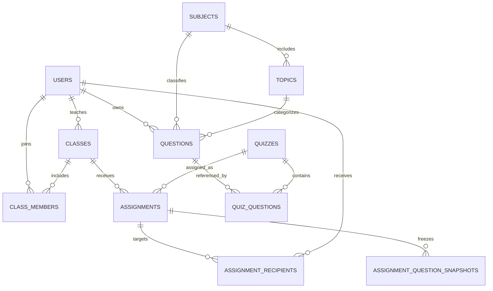

# QuizAI Desktop — Project Decision Log

Trạng thái: Vòng 1–7 đã xác nhận (DEC-001 đến DEC-034). Nghiệp vụ MVP được khóa ở mức product requirements; chi tiết hiện thực chưa được mặc định là quyết định đã chấp nhận.
Cập nhật: 2026-11-05 — phiên bản 7.

## Tên đề tài đã chốt
SỬ DỤNG GIAO THỨC TCP, HTTPS, WEBSOCKET VÀ MÔ HÌNH CLIENT–SERVER ĐỂ XÂY DỰNG HỆ THỐNG QUIZAI DESKTOP HỖ TRỢ HỌC TẬP VÀ QUẢN LÝ KIỂM TRA CÓ TÍCH HỢP TRÍ TUỆ NHÂN TẠO.

## Nền tảng đã chốt từ các vòng trao đổi trước
- Java + JavaFX + CSS cho ứng dụng người học và quản trị.
- Java + Spring Boot cho server; PostgreSQL lưu dữ liệu.
- Gemini API tích hợp ở server; Apache PDFBox cho PDF. Bổ sung trình trích xuất DOCX/TXT và văn bản nhập trực tiếp theo DEC-005 (thư viện DOCX chưa chốt).
- HTTPS/REST API là kênh nghiệp vụ; WSS/WebSocket cho thông báo.
- Có module TCP Socket Java trực tiếp theo DEC-004.
- Ứng dụng Desktop kết nối server qua Internet; không làm website hay app di động.

## Vòng 1 — ACCEPTED

### DEC-001 — Giảng viên quản lý nhiều sinh viên
- **Trạng thái:** ACCEPTED.
- **Quyết định:** QuizAI Admin là giao diện cho giảng viên quản lý nhiều sinh viên.
- **Tác động:** Thiết kế vai trò TEACHER và STUDENT; quan hệ giảng viên–sinh viên được tổ chức theo lớp (DEC-016).
- **Chưa quyết định:** Một sinh viên có thể thuộc nhiều lớp hay không; quyền hạn admin toàn hệ thống.

### DEC-002 — Tự học hoàn toàn và nhận bài từ Admin
- **Trạng thái:** ACCEPTED.
- **Quyết định:** Người học được chủ động tạo đề/luyện tập/chat AI, đồng thời nhận bài do giảng viên giao.
- **Tác động:** Phân tách chế độ PRACTICE và ASSIGNED_EXAM; quản lý riêng quyền, nguồn đề, kết quả và chính sách xem lời giải. Đề tự học không tự động thành đề kiểm tra chính thức.

### DEC-003 — Tắt AI hỗ trợ trong bài kiểm tra
- **Trạng thái:** ACCEPTED.
- **Quyết định:** Trong chế độ làm bài kiểm tra được giao, ứng dụng không cung cấp công cụ AI hỗ trợ.
- **Tác động:** Client ẩn/vô hiệu hóa gia sư AI và giải thích; backend từ chối yêu cầu hỗ trợ AI gắn với attempt đang thi; server không trả đáp án chuẩn trước khi nộp và chấm bài ở phía server.
- **Giới hạn:** Không thể bảo đảm ngăn người dùng mở công cụ AI bên ngoài máy tính; đây là chính sách bên trong QuizAI, không phải giải pháp chống gian lận tuyệt đối.

### DEC-004 — Module quản lý trạng thái kết nối TCP riêng
- **Trạng thái:** ACCEPTED.
- **Quyết định:** Xây dựng module Java Socket/ServerSocket gửi heartbeat/ACK và theo dõi trạng thái kết nối như một phần thực hành TCP trực tiếp, tách với nghiệp vụ qua HTTPS và thông báo qua WSS.
- **Tác động:** Định nghĩa thông điệp có phân khung, timeout, xử lý nhiều client và reconnect; chỉ lưu trạng thái kết nối ở mức cần thiết.
- **Giới hạn thiết kế:** Không truyền mật khẩu, đáp án hoặc dữ liệu nhạy cảm trên kênh TCP tự thiết kế thiếu bảo mật. Nếu sử dụng qua Internet cần thiết kế an toàn (TLS/xác thực, hạn chế truy cập) hoặc chỉ demo TCP trên LAN/localhost — cách triển khai cuối cùng chưa chốt.

## Quy tắc thay đổi quyết định
- Không tự thêm chức năng ngoài phạm vi đã ACCEPTED.
- Thay đổi một quyết định phải ghi `CHANGE REQUEST`, lý do, tác động và được người dùng xác nhận trước khi triển khai.
- PENDING/DEFERRED/REJECTED không được tự động chuyển thành ACCEPTED.

## Vòng 2 — ACCEPTED

### DEC-005 — Hỗ trợ PDF, DOCX, TXT và nhập văn bản
- **Trạng thái:** ACCEPTED.
- **Quyết định:** Luồng tạo câu hỏi hỗ trợ bốn nguồn đầu vào: PDF, DOCX, TXT và văn bản người dùng nhập/dán trực tiếp.
- **Tác động:** Xây dựng tầng `DocumentExtractor` chung, tách bộ đọc PDF/DOCX/TXT/text-input; chuẩn hóa văn bản trước khi gọi AI; kiểm tra kiểu, kích thước, encoding và lỗi tệp; bổ sung bộ kiểm thử cho từng nguồn.
- **Giới hạn:** Chưa mặc định hỗ trợ OCR cho PDF quét ảnh, nội dung hình trong DOCX hoặc mọi loại tài liệu phức tạp. Thư viện xử lý DOCX cần chọn ở giai đoạn thiết kế chi tiết.

### DEC-006 — Tách ngân hàng đề cá nhân và ngân hàng đề giảng viên
- **Trạng thái:** ACCEPTED.
- **Quyết định:** Sinh viên tạo và quản lý bộ đề riêng phục vụ tự học; giảng viên có ngân hàng câu hỏi/bộ đề riêng. Không tự động chia sẻ bộ đề sinh viên cho giảng viên.
- **Tác động:** Thiết kế owner_id, scope/visibility, quyền đọc/sửa; tách đề luyện tập với đề được giao. Giảng viên không có quyền xem đề riêng của sinh viên chỉ vì là người quản lý.
- **Bổ sung DEC-019, DEC-020:** Ngân hàng giảng viên phân loại theo môn học, chủ đề, độ khó; MVP không hỗ trợ chia sẻ giữa giảng viên.

### DEC-007 — Giảng viên duyệt và chỉnh sửa từng câu trước khi giao thi
- **Trạng thái:** ACCEPTED.
- **Quyết định:** Câu hỏi do AI tạo phải có bước giảng viên rà soát, chỉnh sửa và phê duyệt trước khi được sử dụng trong bài kiểm tra chính thức.
- **Tác động:** Cần trạng thái bản nháp/đã duyệt, nguồn gốc AI, dấu vết người duyệt và phiên bản câu hỏi. Đề thi đang có lượt làm không được thay đổi nội dung tùy tiện; cần snapshot/phiên bản ổn định.
- **Giới hạn:** Chưa mặc định có quy trình phê duyệt nhiều cấp hoặc nhật ký kiểm duyệt phức tạp.

### DEC-008 — Gia sư AI hỏi đáp dựa trên PDF đã nhập
- **Trạng thái:** ACCEPTED.
- **Quyết định:** Chat AI có thể dùng nội dung PDF đã nhập làm ngữ cảnh để hỗ trợ trả lời câu hỏi học tập.
- **Tác động:** Lưu/liên kết nội dung trích xuất với tài liệu có quyền truy cập; giới hạn độ dài đầu vào, lựa chọn đoạn nội dung liên quan và xử lý tài liệu quá dài.
- **Giới hạn:** Chưa cam kết RAG/embedding, truy xuất ngữ nghĩa hoặc trích dẫn trang chính xác trong MVP. DEC-005 không tự động mở rộng chat theo DOCX/TXT nếu chưa được xác nhận.

### DEC-009 — Giảng viên nhập tài liệu và tạo câu hỏi bằng AI
- **Trạng thái:** ACCEPTED (yêu cầu bổ sung được người dùng nêu rõ).
- **Quyết định:** QuizAI Admin cho phép giảng viên nhập tài liệu (theo định dạng DEC-005) và yêu cầu AI tạo bộ câu hỏi; sau đó giảng viên rà soát, chỉnh sửa và phê duyệt theo DEC-007.
- **Tác động:** Tái sử dụng pipeline trích xuất tài liệu và dịch vụ Gemini; khác biệt ở quyền sở hữu, quản lý bản nháp, duyệt câu hỏi và ngân hàng giảng viên. Không nhân đôi logic AI thành hai bộ mã riêng.

### DEC-010 — Ngân hàng câu hỏi giảng viên và tạo nhiều bộ đề
- **Trạng thái:** ACCEPTED (định hướng sản phẩm); DEFERRED (tự động tạo nhiều bộ đề đa dạng trong MVP).
- **Quyết định:** Giảng viên có thể tích lũy câu hỏi được phê duyệt vào ngân hàng câu hỏi. Hướng phát triển sau là chọn/tổng hợp những câu hỏi này thành các bộ đề khác nhau.
- **Tác động:** Tách mô hình `question_bank`/`questions` khỏi `quizzes` và dùng bảng liên kết câu hỏi–bộ đề, có thứ tự, snapshot/phiên bản. Tránh thiết kế mỗi câu hỏi chỉ thuộc đúng một bộ đề.
- **Chưa quyết định:** Cách chọn câu hỏi (thủ công/ngẫu nhiên/theo chủ đề/độ khó), tính duy nhất, trộn đáp án, số mã đề, phiên bản và thời điểm đưa tính năng tự động vào phạm vi thực hiện.

## Vòng 3 — ACCEPTED (nghiệp vụ kiểm tra)

### DEC-011 — Có thời gian mở đề, hạn nộp và thời lượng làm bài
- **Trạng thái:** ACCEPTED.
- **Quyết định:** Giảng viên cấu hình thời điểm mở đề (`opens_at`), hạn nộp (`closes_at`) và thời lượng tối đa cho mỗi lượt (`duration_minutes`).
- **Tác động:** Server cấp quyền bắt đầu trong khung thời gian; mỗi attempt có `started_at`, `deadline_at` và trạng thái. Mốc hết hạn hiệu lực cần dựa vào cả thời lượng và hạn đóng bài, không chỉ đồng hồ client.
- **Còn mở:** Quy tắc có tự động nộp khi hết giờ và xử lý bài offline đồng bộ muộn hay không chưa được chốt.

### DEC-012 — Cho tiếp tục làm bài khi mất mạng, lưu tạm tại client
- **Trạng thái:** ACCEPTED.
- **Quyết định:** Khi mất kết nối Internet trong lúc làm bài, client vẫn cho phép làm tiếp và lưu câu trả lời tạm trên thiết bị để có thể đồng bộ trở lại.
- **Tác động:** Cần storage local cho draft, định danh `attempt_id`, cơ chế khôi phục, xử lý trạng thái kết nối và đồng bộ; client phải phân biệt `PENDING_SYNC` với `SUBMITTED` đã được server xác nhận. Không được đánh dấu đã nộp thành công trước phản hồi server.
- **Quan ngại an toàn:** Client có thể chỉnh giờ/tệp nháp; nếu đồng bộ sau hạn thì khó chứng minh câu trả lời được ghi trước hạn. Chưa chốt có chấp nhận bài nộp muộn hay cần một chính sách giám thị/ngoại lệ.
- **Giới hạn:** Quyết định này không mặc định cho phép gia hạn thời gian hay bắt buộc nhận bài sau hạn.

### DEC-013 — Giảng viên cấu hình số lần làm, mặc định 1
- **Trạng thái:** ACCEPTED.
- **Quyết định:** Mỗi bài được giao có `max_attempts` do giảng viên đặt, mặc định là 1.
- **Tác động:** Server đếm và kiểm soát lượt làm; mỗi attempt riêng biệt; không tính mỗi lần reconnect là một lượt mới. Khi nộp, chống gửi trùng bằng transaction/idempotency và khóa trạng thái lượt làm.
- **Còn mở:** Quy tắc lấy điểm cuối cùng, điểm cao nhất hay điểm trung bình nếu có nhiều lượt chưa chốt.

### DEC-014 — Giảng viên tùy chỉnh thời điểm công bố kết quả
- **Trạng thái:** ACCEPTED.
- **Quyết định:** Giảng viên được cấu hình thời điểm công bố điểm/đáp án theo chính sách bài kiểm tra.
- **Tác động:** Server là nơi thực thi quyền truy cập kết quả và giải thích; API không gửi đáp án/điểm trước thời điểm được phép. Client hiển thị trạng thái theo dữ liệu server.
- **Còn mở:** Có cho công bố điểm trước đáp án và các chế độ hiển thị cụ thể hay không chưa chốt.

### DEC-015 — Đóng băng phiên bản đề khi giao bài
- **Trạng thái:** ACCEPTED.
- **Quyết định:** Tại thời điểm giảng viên giao bài kiểm tra, hệ thống tạo phiên bản đề bất biến cho bài giao. Chỉnh sửa ngân hàng câu hỏi sau đó không làm thay đổi nội dung hay đáp án chuẩn của bài đã giao.
- **Tác động:** Cần `quiz_snapshot` hoặc các bản ghi `assignment_questions` với nội dung, lựa chọn và đáp án chuẩn được đóng băng; tất cả attempt cùng bài giao sử dụng phiên bản đã chốt. Muốn thay đề đã giao phải có nghiệp vụ riêng (chưa được chấp nhận).

## Edge cases và mâu thuẫn cần giải quyết
- **OFFLINE-01 — Đồng bộ sau hạn:** DEC-012 cho tiếp tục làm bài offline nhưng DEC-011 có hạn nộp do server kiểm soát. Chưa thể suy ra rằng server phải chấp nhận bài gửi sau hạn. Cần quyết định chính sách riêng.
- **TIME-01 — Giờ client sai:** Đồng hồ server là nguồn tham chiếu về thời hạn; client không được tự kéo dài deadline bằng chỉnh đồng hồ.
- **DUP-01 — Gửi trùng:** Một lượt làm nộp nhiều request vẫn chỉ được lưu/chấm một lần; nộp trùng không tạo attempt mới.
- **DEVICE-01 — Nhiều thiết bị:** Chưa chốt một người được mở một attempt trên nhiều máy hay không và nếu có thì hợp nhất draft theo nguyên tắc nào.
- **RESULT-01 — Công bố:** DEC-014 đã chốt quyền cấu hình thời điểm, chưa chốt chế độ hiển thị (điểm riêng/đáp án riêng).
- **SCORE-01 — Nhiều lượt:** DEC-013 chưa xác định cách tính điểm tổng hợp của một assignment có nhiều attempt.
- **SNAPSHOT-01 — Bất biến:** DEC-015 yêu cầu sửa câu hỏi ngân hàng không làm đổi đề đã giao; không sử dụng tham chiếu câu hỏi đang sửa để chấm attempt cũ.

## Vòng 4 — ACCEPTED (lớp học, phân quyền, ngân hàng câu hỏi)

### DEC-016 — Quản lý giảng viên và sinh viên theo lớp học
- **Trạng thái:** ACCEPTED.
- **Quyết định:** Giảng viên tạo/quản lý lớp học, sinh viên tham gia lớp; giảng viên quản lý nhiều sinh viên thông qua các lớp.
- **Tác động:** Đề xuất `classes(id, teacher_id, name, join_code_hash_or_token, status, ...)` và `class_members(class_id, student_id, joined_at, status, ...)`; khóa ngoại đến `users`. Bài giao phải liên kết với lớp hoặc tập người nhận được xác định tại thời điểm giao để tránh thay đổi người nhận ngoài ý muốn.
- **Chưa quyết định:** Một sinh viên có thể tham gia nhiều lớp hay không; lớp có thể có đồng giảng viên không; quy tắc giảng viên sửa/xóa lớp có bài thi đang mở.

### DEC-017 — Sinh viên tham gia lớp bằng mã
- **Trạng thái:** ACCEPTED.
- **Quyết định:** Giảng viên tạo lớp và cung cấp mã tham gia, sinh viên đăng nhập và nhập mã để tham gia.
- **Tác động:** API tạo lớp/đổi mã và API tham gia lớp; kiểm tra mã hợp lệ, lớp còn hoạt động, quyền của tài khoản và thành viên đã tồn tại; hạn chế đoán mã bằng giới hạn tần suất. Mã lớp không phải token xác thực cho quyền quản trị.
- **Chưa quyết định:** Mã có hết hạn/được thay mới hay không; có cần giảng viên duyệt yêu cầu tham gia không.

### DEC-018 — Giảng viên xem thêm thống kê tự học tổng hợp
- **Trạng thái:** ACCEPTED.
- **Quyết định:** Ngoài dữ liệu bài kiểm tra do mình giao, giảng viên được xem thống kê tổng hợp tự học của sinh viên trong lớp mình phụ trách; không mặc định được đọc nội dung chat AI, tài liệu hoặc bộ đề riêng của sinh viên.
- **Tác động:** Cần endpoint `GET /classes/{id}/students/{studentId}/summary` (minh họa) kiểm tra cả quyền giảng viên sở hữu lớp và tư cách thành viên của sinh viên. Các số liệu gợi ý gồm số phiên học, số câu đã làm, tỷ lệ đúng, điểm luyện tập tổng hợp; thời gian học được ghi nhận không đồng nghĩa mức độ tập trung.
- **Chưa quyết định:** Có hiển thị thống kê sinh viên ngoài lớp đang phụ trách hay không (mặc định thiết kế đề xuất là không); phạm vi thời gian, thời hạn lưu và mức độ chi tiết chỉ số.

### DEC-019 — Ngân hàng câu hỏi tổ chức theo môn, chủ đề, độ khó
- **Trạng thái:** ACCEPTED.
- **Quyết định:** Ngân hàng câu hỏi riêng của giảng viên phân loại, lọc theo môn học, chủ đề và độ khó để quản lý, rà soát và chọn câu hỏi cho bộ đề.
- **Tác động:** Đề xuất các bảng/thuộc tính `subjects`, `topics`, `questions.difficulty`, `questions.owner_id`, `questions.approval_status`; tạo index tìm kiếm theo owner, subject, topic, difficulty. Câu hỏi trong ngân hàng độc lập với phiên bản đề đã giao (DEC-015).
- **Giới hạn:** Chưa chốt thuật toán sinh ngẫu nhiên nhiều mã đề; DEC-010 giữ DEFERRED phần tự động tạo nhiều bộ đề trong MVP.

### DEC-020 — Không chia sẻ ngân hàng câu hỏi giữa giảng viên trong MVP
- **Trạng thái:** ACCEPTED.
- **Quyết định:** Mỗi giảng viên quản lý ngân hàng riêng, không chia sẻ/copy/đồng biên tập ngân hàng giữa các giảng viên ở MVP.
- **Tác động:** Mỗi truy vấn ngân hàng phải lọc theo owner_id và kiểm tra quyền tại server; không xây dựng chức năng mời cộng tác hoặc quyền sửa chung.
- **Giới hạn:** Chưa xác định cơ chế chuyển quyền sở hữu khi giảng viên nghỉ hoặc xóa tài khoản; không mặc định tạo chức năng này.

## Tác động ERD và phân quyền sau Vòng 4

### ERD cập nhật — đề xuất thiết kế, chưa khóa toàn bộ schema

- `ASSIGNMENT_RECIPIENTS` và `ASSIGNMENT_QUESTION_SNAPSHOTS` là phương án thiết kế gợi ý để ổn định danh sách người nhận và câu hỏi tại thời điểm giao, không phải những bảng đã được chốt tuyệt đối.
- Đối với ngân hàng riêng, `owner_id` phân biệt chủ sở hữu; học sinh và giảng viên đều có quyền sở hữu tài nguyên riêng theo DEC-006.

### Ma trận quyền cơ bản
| Hành động | Sinh viên | Giảng viên | Server |
|---|---|---|---|
| Tham gia lớp bằng mã hợp lệ | Trong tài khoản của mình | Tạo/quản lý mã lớp của mình | Xác thực và kiểm tra điều kiện |
| Xem danh sách thành viên lớp | Chưa chốt phạm vi | Chỉ lớp mình phụ trách | Kiểm tra quan hệ teacher/class |
| Tạo đề AI từ tài liệu | Tạo đề cá nhân | Tạo đề trong ngân hàng của mình | Kiểm tra owner, gọi AI |
| Đọc chat AI, tài liệu riêng của sinh viên | Của chính mình | Không mặc định | Chặn truy cập trái quyền |
| Xem kết quả bài kiểm tra | Kết quả của mình theo thời điểm công bố | Bài giao thuộc lớp mình phụ trách | Kiểm tra assignment và lớp |
| Xem thống kê tự học tổng hợp | Của chính mình | Sinh viên thuộc lớp mình phụ trách | Chỉ trả aggregate được phép |
| Chỉnh sửa ngân hàng câu hỏi | Của chính mình theo chế độ tự học | Chỉ ngân hàng của mình | Kiểm tra owner_id và phiên bản đề |

## Edge cases còn mở sau Vòng 4
- **CLASS-01:** Một sinh viên tham gia nhiều lớp hay chỉ một lớp? Có trùng tên lớp không?
- **CLASS-02 — PARTIALLY CLOSED bởi DEC-030:** Giữ kết quả cũ và hủy quyền bắt đầu bài chưa làm; lượt đang làm còn mở.
- **CLASS-03:** Mã lớp có vòng đời, hạn sử dụng và cơ chế thay mới như thế nào?
- **PRIVACY-01:** Giảng viên chỉ xem thống kê aggregate; định nghĩa chỉ số và giới hạn thời gian lưu cần cụ thể hóa.
- **BANK-01:** Giảng viên không được đọc/copy ngân hàng người khác trong MVP; tài khoản quản trị hệ thống có ngoại lệ không chưa chốt.
- **OFFLINE-01 — PARTIALLY CLOSED bởi DEC-023, DEC-027:** Giảng viên duyệt/từ chối có lý do; bài bị từ chối có tính lượt hay không còn mở.
- **DEVICE-01 — PARTIALLY CLOSED bởi DEC-028:** Giảng viên cho phép chuyển máy; xử lý bản nháp offline từ máy cũ còn mở.
- **SCORE-01 — CLOSED bởi DEC-029:** Chọn điểm cao nhất của các lượt hợp lệ.
- **RESULT-01:** Quy định xem điểm và đáp án theo thời điểm/chế độ công bố.
- **SOCKET-01:** Đã chốt DEC-025: TCP Socket trực tiếp chỉ demo LAN/localhost, không public Internet.

## Vòng 5 — ACCEPTED (tài khoản, một thiết bị thi, offline, TCP demo)

### DEC-021 — Mọi người tự đăng ký và chọn vai trò
- **Trạng thái:** ACCEPTED (bổ sung bởi DEC-026).
- **Quyết định của người dùng:** Khi tự đăng ký, người dùng có thể chọn vai trò sinh viên hoặc giảng viên. DEC-026 xác định quyền giảng viên có hiệu lực ngay sau đăng ký thành công.
- **Tác động:** Giao diện đăng ký hiển thị lựa chọn vai trò; backend tiếp nhận lựa chọn và cần mô hình quyền tương ứng; phải xây dựng chính sách bảo vệ chức năng giảng viên trước người đăng ký giả mạo.
- **RỦI RO NGHIÊM TRỌNG ĐÃ ĐƯỢC CHẤP NHẬN:** DEC-026 cho phép tự cấp vai trò TEACHER sau khi đăng ký thành công, không yêu cầu xác minh giảng viên. Bất kỳ ai cũng có thể tạo tài khoản TEACHER. Server vẫn phải xác thực tài khoản, giới hạn quyền tài nguyên theo owner/lớp và không được cấp đặc quyền quản trị hệ thống (SUPERADMIN) từ lựa chọn này. Không được nói rằng giảng viên đã được xác minh.

### DEC-022 — Mỗi lượt thi chỉ cho phép một thiết bị
- **Trạng thái:** ACCEPTED.
- **Quyết định:** Mỗi `quiz_attempt` đang thực hiện được ràng buộc với một thiết bị/phiên thi; thiết bị khác không được mở đồng thời cùng lượt đó.
- **Tác động:** Cần `attempt_id`, device/session binding, kiểm tra server-side khi bắt đầu và khi nộp; xử lý token, kết nối lại, chuyển thiết bị và reset máy.
- **Còn mở:** Phương án khôi phục khi hỏng/mất máy; cách nhận diện thiết bị và cơ chế cấp lại quyền chưa khóa. Dấu định danh thiết bị thuần ở client có thể giả mạo, không thể bảo đảm chống gian lận tuyệt đối.

### DEC-023 — Bài offline đồng bộ sau hạn chờ giảng viên xét duyệt
- **Trạng thái:** ACCEPTED.
- **Quyết định:** Client được lưu tạm và đồng bộ bài làm sau hạn; server tiếp nhận dưới trạng thái chờ giảng viên xem xét, **không tự xác nhận hợp lệ, không tự công bố điểm chính thức**.
- **Tác động:** Tách `PENDING_SYNC` (client) khỏi `PENDING_REVIEW` (server đã nhận), `ACCEPTED_LATE`/`REJECTED_LATE` (sau khi giảng viên quyết định). Lưu `server_received_at`, `attempt_id`, dữ liệu bài và thông tin phục vụ đối chiếu; cần audit log người duyệt, thời điểm và lý do nếu có.
- **Hạn chế:** Server không thể chứng minh chắc chắn thời điểm câu trả lời offline được nhập chỉ từ timestamp phía client. Chính sách duyệt/từ chối và tác động lên số lượt thi cần chốt chi tiết trước khi code.

### DEC-024 — Chỉ lưu tạm lượt thi và câu trả lời cần khôi phục
- **Trạng thái:** ACCEPTED.
- **Quyết định:** Lưu trên thiết bị tối thiểu trạng thái lượt thi và câu trả lời phục vụ khôi phục/sync; không tự mở rộng thành chế độ tải toàn bộ thư viện, chat, tài liệu và bộ đề offline.
- **Tác động:** Local draft gắn user_id + attempt_id + thiết bị; lưu bền vững bằng cơ chế phù hợp; ưu tiên hạn chế và mã hóa dữ liệu nhạy cảm trong phạm vi khả thi; xóa sau khi server xác nhận và hết nhu cầu khôi phục; không coi timestamp phía client là bằng chứng chống gian lận.
- **Còn mở:** Cơ chế mã hóa/khóa cục bộ, thời hạn lưu bản nháp và chính sách xóa khi đăng xuất/chuyển tài khoản.

### DEC-025 — TCP Socket chỉ chạy LAN/localhost để trình diễn
- **Trạng thái:** ACCEPTED.
- **Quyết định:** Module Java `Socket`/`ServerSocket` heartbeat/ACK và theo dõi trạng thái kết nối chỉ triển khai trong môi trường localhost hoặc LAN cho mục đích demo kiến thức TCP trực tiếp.
- **Tác động:** Không public cổng TCP riêng trên Internet; giới hạn bind interface/cổng, timeout, framing, thread pool và log kết nối; tách khỏi kết nối online của QuizAI Client/Admin vốn dùng HTTPS/WSS.
- **Giới hạn:** Trạng thái TCP demo LAN không phải nguồn sự thật về việc sinh viên đang online qua Internet; Online status của sản phẩm chính cần lấy từ WebSocket/API nếu có nhu cầu.

### Tác động bảo mật và kiến trúc sau Vòng 5
- **Tài khoản (cập nhật bởi DEC-026):** Signup cho chọn vai trò và tự cấp quyền TEACHER ngay. Backend vẫn phải kiểm tra token, vai trò và quyền owner/lớp trên từng API, không cấp quyền SUPERADMIN; rủi ro mạo danh giảng viên đã được chấp nhận.
- **Thi một thiết bị:** `attempts` cần ràng buộc thiết bị/phiên; đồng thời cần quy trình giải quyết mất máy/chuyển máy để không khóa sinh viên vĩnh viễn.
- **Offline:** Client lưu nháp cần khôi phục; server phân biệt đã nhận, đang chờ duyệt, đã duyệt, từ chối; chống gửi trùng bằng `attempt_id` và transaction/idempotency. Giảng viên duyệt ngoại lệ có lưu audit.
- **TCP:** Demo local/LAN độc lập; không đưa heartbeat TCP tự thiết kế lên Internet. Bản Internet sử dụng HTTPS/WSS có TLS.

### Edge cases phát hiện ở Vòng 5 (đối chiếu với quyết định Vòng 6 bên dưới)
- **AUTH-01 — CLOSED bởi DEC-026:** Được cấp ngay; rủi ro giả mạo giảng viên được ghi nhận, không được che giấu.
- **DEVICE-02 — PARTIALLY CLOSED bởi DEC-028:** Giảng viên cho phép chuyển thiết bị; cơ chế phục hồi dữ liệu chưa đồng bộ và chuyển máy lúc offline còn mở.
- **OFFLINE-02 — PARTIALLY CLOSED bởi DEC-027:** Giảng viên duyệt/từ chối và bắt buộc ghi lý do; tiêu chí đánh giá hợp lệ dựa trên bằng chứng offline không được đảm bảo tuyệt đối.
- **OFFLINE-03:** Bản nháp offline quá hạn được lưu trong bao lâu, khi nào xóa, và bài bị từ chối có tính là một lượt thi?
- **SOCKET-02:** Module TCP chỉ demo LAN, không dùng trạng thái này để phán định online của client qua Internet.

## Quy tắc thay đổi và phạm vi
- Mọi DEC trạng thái ACCEPTED chỉ được thay đổi bằng CHANGE REQUEST được người dùng đồng ý.
- Các edge case chưa chốt vẫn PENDING, không được tự động thực thi dưới dạng yêu cầu nghiệp vụ.
- DEC-010: Ngân hàng câu hỏi đã ACCEPTED; tính năng tự động tạo nhiều mã đề từ câu hỏi lớn vẫn DEFERRED khỏi MVP.
- Đã chốt chính sách căn bản OFFLINE-01 ở DEC-023; cần chốt tiêu chí xét duyệt và bảo mật vai trò ở Vòng 6 trước khi triển khai đầy đủ.

## Vòng 6 — ACCEPTED (quyền giảng viên, bài trễ, đổi thiết bị, điểm thi, rời lớp)

### DEC-026 — Đăng ký là có quyền giảng viên ngay
- **Trạng thái:** ACCEPTED.
- **Quyết định:** Người đăng ký chọn vai trò TEACHER và hoàn thành đăng ký sẽ nhận quyền TEACHER ngay, không qua quy trình phê duyệt, thư mời hay mã kích hoạt.
- **Tác động:** Server cấp vai trò từ luồng đăng ký hợp lệ; Spring Security kiểm tra vai trò và quyền sở hữu tài nguyên từng endpoint. Quyền TEACHER **không đồng nghĩa** với quyền SUPERADMIN, không cho đọc dữ liệu của giảng viên khác hoặc sinh viên ngoài lớp mình quản lý. Với mô hình này, ứng dụng không thể xác nhận người đăng ký thực sự là giảng viên.
- **Rủi ro bảo mật có chủ đích:** Người lạ có thể tự tạo lớp và mạo danh giảng viên. Phải trình bày rõ trong báo cáo là giới hạn sản phẩm; mọi đề xuất bắt xác minh giảng viên sau này là CHANGE REQUEST.

### DEC-027 — Duyệt/từ chối bài nộp muộn bắt buộc có lý do
- **Trạng thái:** ACCEPTED.
- **Quyết định:** Bài làm offline gửi tới server sau hạn vào trạng thái `PENDING_REVIEW`. Giảng viên có quyền `ACCEPTED_LATE` hoặc `REJECTED_LATE` và phải nhập lý do không rỗng.
- **Tác động:** Audit lưu người xét duyệt, thời điểm, quyết định, lý do, thời điểm server nhận bài; endpoint quyết định phải xác thực quyền quản lý bài giao. Điểm chính thức và kết quả tổng hợp chỉ dùng bài muộn khi đã được duyệt. Không tin dấu thời gian do client tự khai là chứng cứ chắc chắn.
- **Chưa khóa:** Bài bị từ chối có tiêu hao một lượt làm hay không; tiêu chí và giới hạn thời gian cho giảng viên xử lý trường hợp muộn.

### DEC-028 — Giảng viên cho phép chuyển thiết bị trong khi thi
- **Trạng thái:** ACCEPTED.
- **Quyết định:** Với bài thi một thiết bị/một lượt (DEC-022), giảng viên có thể phê duyệt chuyển lượt thi sang thiết bị khác.
- **Tác động:** Server thu hồi binding/phiên thiết bị cũ, gắn thiết bị mới, lưu audit người phê duyệt/thời điểm và không reset thời lượng tự động. Chỉ dữ liệu đã đồng bộ lên server mới có thể được khôi phục đáng tin cậy; bản nháp chỉ còn ở máy cũ không mặc nhiên chuyển được sang máy mới.
- **Chưa khóa:** Lượt thi mất mạng trên máy cũ không thể được server xác minh/hủy tức thời; cần quy tắc khi máy cũ trở lại và gửi bản nháp trễ sau khi chuyển.

### DEC-029 — Điểm cao nhất là điểm tổng kết
- **Trạng thái:** ACCEPTED.
- **Quyết định:** Khi bài giao cho nhiều lượt làm, điểm tổng kết lấy giá trị lớn nhất trong số các lượt làm hợp lệ, đã được chấm và được phép tính điểm.
- **Tác động:** `final_score = MAX(eligible_attempt.score)`; không tính `PENDING_REVIEW`, `REJECTED_LATE`, bản nháp chưa nộp. Nếu lượt muộn sau đó được duyệt, server tính lại điểm tổng kết. Công bố kết quả vẫn tuân thủ DEC-014.
- **Chưa khóa:** Nếu không có lượt hợp lệ thì trạng thái kết quả là 'chưa có điểm', không được tự gán 0 chỉ để tiện báo cáo.

### DEC-030 — Rời lớp giữ kết quả cũ, hủy quyền bắt đầu bài chưa làm
- **Trạng thái:** ACCEPTED.
- **Quyết định:** Khi sinh viên rời lớp, kết quả bài đã làm trước đó được giữ lại; các bài đã giao nhưng chưa bắt đầu không còn được quyền khởi động lượt thi mới.
- **Tác động:** `class_members` chuyển trạng thái rời lớp, không xóa cứng dữ liệu có lịch sử; bài/attempt đã nộp và audit phải giữ được quan hệ để giảng viên xem kết quả cũ theo quyền. API start-attempt phải kiểm tra thành viên hiện hành. Việc hủy quyền bắt đầu bài chưa làm không có nghĩa xóa bài giao và kết quả.
- **Chưa khóa:** Với lượt thi **đang làm** khi rời lớp, cho hoàn tất/nộp hay buộc dừng vẫn cần quyết định; xử lý riêng với trường hợp bài offline đang chờ đồng bộ.

## Đánh giá sau Vòng 6 — MVP readiness
- **Đã đủ cơ sở:** mô hình lớp bằng mã; phân quyền theo owner/lớp; ngân hàng đề riêng; workflow kiểm duyệt; đề bất biến; nhiều lượt và điểm cao nhất; xét duyệt nộp muộn có lý do; chuyển thiết bị có phép; module TCP demo LAN; HTTPS/WSS trên Internet.
- **Chưa đủ để đóng băng 100% nghiệp vụ kiểm tra:** (1) lượt đang thi khi sinh viên rời lớp; (2) số lượt tiêu hao đối với bài nộp muộn bị từ chối; (3) trường hợp thiết bị cũ đã offline trở lại và gửi bản nháp sau khi được chuyển thiết bị. Cần quyết định tối thiểu về ba nhánh này trước khi chốt state machine và ERD chi tiết. Quy tắc tự nộp khi hết giờ cũng cần được xác định ở thiết kế bài thi, nhưng có thể chọn trong cùng đợt quyết định cuối.
- **Rủi ro đã chấp nhận, không được tự sửa:** tự đăng ký có quyền giảng viên ngay (DEC-026); đây là tài khoản TEACHER tự khai, không phải danh tính đã xác minh.
- **DEFERRED:** thuật toán tạo nhiều mã đề tự động từ ngân hàng lớn (DEC-010). Không tự động đưa vào MVP.

## CHANGE CONTROL
- Mọi thay đổi DEC-001 đến DEC-030 cần CHANGE REQUEST và đồng ý rõ ràng của người dùng.
- Các phần `Chưa khóa` nêu trên là PENDING, không được biến thành luật nghiệp vụ ngầm.
- Không lấy TCP LAN demo làm trạng thái kết nối Internet hoặc làm kênh truyền dữ liệu thi chính thức.

---

## Vòng 7 — ACCEPTED (xử lý ngoại lệ cuối cùng của bài thi)

### DEC-031 — Rời lớp trong lúc đang làm bài: được hoàn thành lượt hiện tại
- **Trạng thái:** ACCEPTED.
- **Quyết định:** Sinh viên rời lớp vẫn được hoàn tất và nộp **lượt thi đã bắt đầu** trước khi rời; không được bắt đầu lượt mới sau khi rời (DEC-030).
- **Tác động:** Kiểm tra quyền **bắt đầu** dựa vào thành viên hiện tại; quyền **tiếp tục/nộp** dựa vào attempt hợp lệ đã được tạo trước thời điểm rời lớp, device binding và deadline. Không xóa attempts hoặc snapshots khi quan hệ lớp chuyển trạng thái.
- **Giới hạn:** Không tự gia hạn giờ làm, hạn nộp hoặc số lượt cho người rời lớp.

### DEC-032 — Bài nộp muộn bị từ chối vẫn tính một lượt
- **Trạng thái:** ACCEPTED.
- **Quyết định:** Attempt nộp muộn bị giảng viên từ chối (`REJECTED_LATE`) **vẫn tiêu hao** một lượt trong `max_attempts` (DEC-013).
- **Tác động:** Trừ lượt theo lần **bắt đầu attempt hợp lệ**, không phụ thuộc kết quả cuối cùng. Khởi động lại ứng dụng, reconnect và gửi lại một lần nộp cùng `attempt_id` không tiêu hao thêm lượt. Điểm của attempt bị từ chối không dùng tính điểm cao nhất (DEC-029).

### DEC-033 — Thu hồi thiết bị cũ: từ chối bản nháp cũ gửi lên
- **Trạng thái:** ACCEPTED.
- **Quyết định:** Sau khi giảng viên duyệt chuyển thiết bị (DEC-028), server từ chối mọi dữ liệu/bản nháp từ **phiên thiết bị cũ** cho attempt đó, kể cả khi thiết bị cũ kết nối lại sau thời gian offline.
- **Tác động:** Cần device/session binding có **thế hệ phiên (binding_version hoặc session_epoch)** trên server. Mọi lệnh lưu/nộp phải kiểm tra phiên còn hiệu lực trước ghi DB. Server ghi audit từ chối; không nhập/gộp bản nháp cũ và không tạo bài nộp muộn để xét duyệt từ phiên bị thu hồi.
- **Thứ tự ưu tiên:** DEC-033 (phiên cũ đã thu hồi) **được kiểm tra trước** DEC-023 (bài muộn chờ duyệt). DEC-023 chỉ áp dụng cho phiên còn hợp lệ.

### DEC-034 — Hết giờ: tự nộp phần đã trả lời
- **Trạng thái:** ACCEPTED.
- **Quyết định:** Khi đến hạn kết thúc của attempt, hệ thống tự nộp các câu đã trả lời; câu bỏ trống không tự điền. Nếu offline, client lưu một **yêu cầu nộp chờ đồng bộ**.
- **Tác động:** Thời hạn hiệu lực gợi ý: `min(assignment.closes_at, attempt.started_at + duration)` tính theo server. Client đếm ngược dựa trên mốc server và thời gian trôi qua; lúc offline chỉ áp dụng tự khóa và xếp hàng nộp theo thời gian quan sát được của client, **không chứng minh** thời gian nhập câu trả lời. Khi trở lại mạng, server nhận bài hợp lệ đúng hạn hoặc `PENDING_REVIEW` nếu nhận sau hạn theo DEC-023; không báo `SUBMITTED` trước khi server xác nhận.
- **Giới hạn:** Không thể bảo đảm auto-submit **đúng thời điểm trên server** khi thiết bị đang offline. Nếu client bị tắt trước thời điểm deadline thì việc tạo và gửi yêu cầu tự nộp cần một cơ chế khôi phục khi mở lại; đây là tình huống triển khai, không được ngầm hứa đã nộp.

## Kiểm tra tương thích chéo sau Vòng 7
| Cặp quyết định | Kết luận | Quy tắc triển khai |
|---|---|---|
| DEC-030 ↔ DEC-031 | Không mâu thuẫn | Rời lớp chặn bắt đầu lượt mới, không hủy lượt đã bắt đầu. |
| DEC-013 ↔ DEC-032 | Không mâu thuẫn | Số lượt dựa trên số attempt được bắt đầu, kể cả attempt nộp muộn bị từ chối. |
| DEC-022/028 ↔ DEC-033 | Không mâu thuẫn | Chỉ một binding còn hiệu lực; phiên cũ bị từ chối kể cả đã lưu offline. |
| DEC-012/023 ↔ DEC-034 | Cần diễn giải nhất quán | Offline vẫn được nhập trước deadline theo đồng hồ client; hết giờ tạo nộp chờ sync, nộp muộn phải qua xét duyệt. |
| DEC-033 ↔ DEC-023 | Đã có thứ tự ưu tiên | Kiểm tra phiên thiết bị trước khi xét tính muộn. |
| DEC-014 ↔ DEC-027/029 | Không mâu thuẫn | Điểm hợp lệ cao nhất chỉ hiển thị theo chính sách công bố; nộp muộn chưa duyệt không tính. |
| DEC-021/026 ↔ quyền riêng tư DEC-018/020 | **RỦI RO BẢO MẬT ĐÃ CHẤP NHẬN** | Tài khoản TEACHER tự khai, nhưng không có quyền hệ thống hoặc quyền tài nguyên của người khác. |
| DEC-004/025 ↔ HTTPS/WSS | Không mâu thuẫn | TCP Socket chạy LAN/localhost để demo, không quyết định online của dịch vụ Internet. |

## Đánh giá khóa yêu cầu MVP — 2026-11-05
- **Kết luận:** `REQUIREMENTS FROZEN — MVP v1.0` ở mức yêu cầu nghiệp vụ, phạm vi tính năng và nguyên tắc kỹ thuật đã chốt trong DEC-001…DEC-034.
- **Không còn blocker nghiệp vụ buộc phải hỏi thêm trước khi phác ERD/API/state machine**. Các chi tiết chưa khóa (cấu trúc bảng/cột, thời gian lưu local draft, hình thức xác thực phiên, công thức tính dữ liệu tổng hợp, UI chi tiết, chính sách hiển thị điểm/đáp án) là `DESIGN OPEN` và phải thiết kế rõ trước khi code các chức năng tương ứng; không tự thêm tính năng mới.
- **Không được đánh đồng** việc đóng băng yêu cầu với chứng minh bảo mật của thi offline: client có thể bị can thiệp, và bài đồng bộ sau hạn phải được giảng viên duyệt như DEC-023/027.
- **DEC-026:** Rủi ro mạo danh giảng viên còn tồn tại theo quyết định đã được người dùng chấp nhận, không được tự thêm xác minh trái yêu cầu; cần giới hạn quyền theo lớp/chủ sở hữu, làm rõ khi báo cáo.
- **DEC-010:** Chức năng tự động sinh nhiều mã đề từ ngân hàng câu hỏi lớn vẫn `DEFERRED`, không vào MVP.
- **Change control:** mọi thay đổi quyết định đã ACCEPTED hoặc đưa chức năng mới vào MVP đều cần CHANGE REQUEST có lý do, tác động và phê duyệt của người dùng.

## Trạng thái các mục PENDING cũ trong lịch sử tài liệu
Các mục `Còn mở`, `Chưa khóa` hoặc `MVP readiness` được ghi trong phần lịch sử vòng 1–6 có thể đã được giải quyết bởi vòng 7. **Khi có xung đột mô tả, quyết định có mã cao hơn và phần Vòng 7 ở trên là nguồn ưu tiên**. Bản yêu cầu sản phẩm hiện hành được chuẩn hóa trong `REQUIREMENTS_BASELINE_v1.0.md`.
