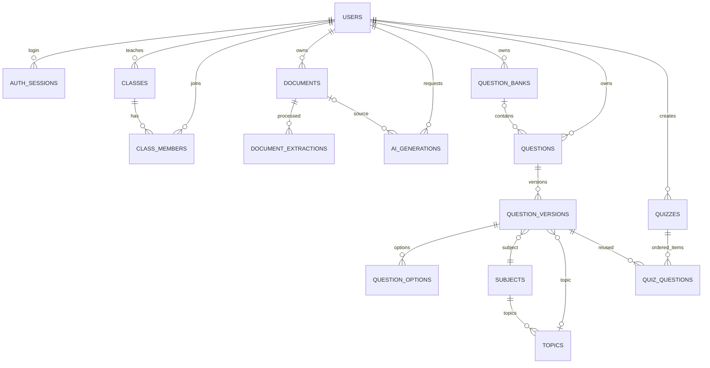
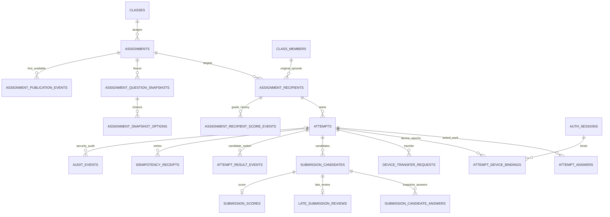
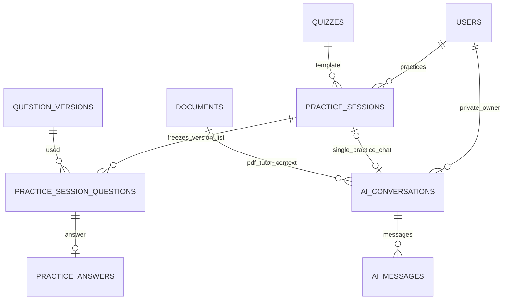

# QuizAI Desktop — DB-05 ERD FINAL FOR APPROVAL v1.0

> **Tình trạng:** `FINAL DESIGN PACKAGE — AWAITING USER APPROVAL`, **không phải schema đã được duyệt hoặc được triển khai**. 2026-11-07. Tài liệu này là bản trình duyệt thống nhất, thay vì nối chồng các ghi chú OPEN lịch sử của ERD v0.12.

**Nguồn ưu tiên:** `PROJECT_DECISIONS_v7.md` (DEC-001…034, FROZEN) → `REQUIREMENTS_BASELINE_v1.0.md` → `QUIZAI_DB_DESIGN_DECISIONS_v0.18.md` (DB-01…34, REVIEW, FINAL-01…12) → ERD này. Khi chưa được người dùng duyệt, cấu trúc dưới đây là **đề xuất kỹ thuật để phê duyệt**, không tự áp dụng.

## 1. Kết quả review và khóa phạm vi

- **12/12 FINAL đã CONFIRMED A**. Tất cả tương thích với DEC và baseline; phần cấu hình Dashboard là thuộc tính per `assignments`, không phát minh thêm điểm học kỳ/đánh giá thành tích.
- **MVP hiện tại:** đăng nhập, lớp, tài liệu, Gemini tạo câu hỏi và PDF tutor, ngân hàng câu hỏi, tự học, giao bài, attempts, device transfer, offline/late, score/release, audit, teacher aggregate; TCP demo **không** tham gia schema nghiệp vụ.
- **DEFERRED:** AI giải thích/chat *sau bài giảng viên giao* theo `AI-ASSIGNED-POST-01=A` (và ba luật pending/history), tự động tạo nhiều mã đề, chia sẻ bank teacher, web/mobile, OCR, hệ thống tính điểm môn học, chức năng teacher verification. Tính năng ngoài baseline cần **Change Request**; không tạo migration dự phòng không cần thiết.
- **Cổng môi trường:** PostgreSQL DEV + TEST riêng, Flyway có version; UUID; storage files/text private ngoài DB; chưa ấn định hạn mức/retention cụ thể trước benchmark/production.
- **Thành phần có database:** duy nhất `quizai-server` qua JDBC/JPA sau phê duyệt; `quizai-client`/`quizai-admin` qua HTTPS REST và WSS; `quizai-common` không chứa Entity; TCP LAN không dùng DB này.

## 2. Tổng quan 37 bảng logic của MVP

Đếm **37** bảng được đề xuất trong v1.0; số lượng bản thân không phải yêu cầu nghiệp vụ. Bảng logic có thể được tinh chỉnh sau code review **nhưng phải xin duyệt lại nếu thay khóa/ràng buộc/bất biến**. Ký hiệu nhóm: `I` identity, `C` class, `K` catalog, `D` documents/generation, `Q` questions/quizzes, `P` practice, `A` assignment, `T` attempt/device, `S` submission/score, `R` retry/audit, `M` AI practice/PDF.

### 2.1. Tài khoản, lớp, tài liệu và câu hỏi

`SUBJECTS` ở cạnh trên là liên kết yêu cầu classify cho teacher-approved versions; với student practice private, subject có thể chưa được gắn. Mermaid không diễn tả conditional FK và owner equality; xem bảng ràng buộc.

### 2.2. Đề giao, attempt, candidate, điểm và công bố

**Chỉ rõ đường liên kết ngược:** `attempts.effective_candidate_id` → `submission_candidates.id` là optional pointer; bắt buộc chứng minh **cùng attempt**, không cho trỏ sang candidate của người khác. `assignment_recipient_score_events` ghi nhận điểm cao nhất của nhiều attempt sau thay đổi nguồn, không được chọn MAX của hai candidate *trong cùng một attempt*.

### 2.3. Tự học và AI trong MVP (không có AI hậu bài giao)

**Giải thích:** Mỗi practice session có tối đa 1 chat, chat PDF theo quyền sở hữu. `assigned_attempt_id` và `context_submission_candidate_id` của AI hậu bài giao **không thuộc schema MVP**, chỉ được mô tả ở phụ lục Change Control.

## 3. Data dictionary: PK, FK và invariants chi tiết

**Quy ước:** tất cả PK nghiệp vụ là UUID; `?` nullable; timestamp là thời điểm server UTC/Instant (`TIMESTAMPTZ` tương đương khi triển khai); ID tham chiếu FK và tùy trường có FK ghép. Cột kỹ thuật `created_at`, `updated_at`, `row_version` bổ sung **chỉ khi cần**, không tạo bảng/chức năng mới. Các tên và trường ở đây là thiết kế trình duyệt, không phải script SQL.

| Nhóm | Bảng | Cột/khóa chính dự kiến | Ràng buộc nghiệp vụ và quyền |
|---|---|---|---|
| I | `users` | id UUID PK; email normalized UQ; password_hash; role; status; created_at; updated_at | STUDENT/TEACHER, không SUPERADMIN; hash mật khẩu; email case-insensitive logic. |
| I | `auth_sessions` | id UUID PK; user_id FK; session_token_hash; device_session_id; created_at; expires_at; revoked_at?; last_seen_at? | Lưu dấu vết login, revoke; không lưu JWT/token plaintext; chỉ active session được dùng auth attempt. |
| C | `classes` | id UUID PK; teacher_id FK; name; join_code_digest UQ?; join_enabled; status; created_at | Một teacher/class; code rotate/disable; digest là keyed HMAC ổn định để lookup, không log plaintext; kiểm tra unique code đang hoạt động. |
| C | `class_members` | id UUID PK; class_id FK; student_id FK; joined_at; left_at?; created_at | Một ACTIVE episode/cặp class+student; rejoin tạo row mới; interval [joined_at,left_at). |
| K | `subjects` | id UUID PK; code UQ; name; active; catalog_version | Danh mục toàn hệ thống được seed qua vận hành; teacher chỉ chọn. |
| K | `topics` | id UUID PK; subject_id FK; code; name; active | UQ(subject_id,code); topic thuộc subject. |
| D | `documents` | id UUID PK; owner_id FK; input_type; storage_key?; filename?; mime_type?; size_bytes?; deleted_at?; created_at | PDF/DOCX/TXT/PASTED_TEXT; không để file/text raw vào DB; soft-delete thu hồi quyền truy cập. |
| D | `document_extractions` | id UUID PK; document_id FK; extraction_no; text_storage_key?; checksum; extractor_version; status; created_at | UQ(document_id,extraction_no); text private outside DB, version immutable khi COMPLETE. |
| D | `ai_generations` | id UUID PK; requested_by FK; source_document_id? FK; source_extraction_id? FK; request_type; status; created_at | Job Gemini backend; câu AI được tạo ở DRAFT; check owner và độ lớn input. |
| Q | `question_banks` | id UUID PK; owner_teacher_id FK; name; archived_at?; created_at | N bank/teacher, không share sang teacher khác. |
| Q | `questions` | id UUID PK; owner_id FK; bank_id? FK; source_generation_id? FK; source_document_id? FK; created_at | Teacher question có 1 primary bank thuộc chính teacher; student private question bank_id=NULL. |
| Q | `question_versions` | id UUID PK; question_id FK; version_no; stem; subject_id? FK; topic_id? FK; difficulty; approval_status; approved_by? FK; approved_at? | UQ(question_id,version_no); APPROVED immutable; phiên bản đã dùng cho practice không in-place edit; teacher publish chỉ APPROVED. |
| Q | `question_options` | id UUID PK; question_version_id FK; position; option_text; is_correct | UQ(question_version_id,position); >=2 lựa chọn & đúng 1 correct khi approve; immutable theo version. |
| Q | `quizzes` | id UUID PK; owner_id FK; quiz_type; title; status; created_at; archived_at? | PRACTICE/TEACHER_QUIZ; owner private; không dùng quiz mutable làm nguồn chấm bài đã giao. |
| Q | `quiz_questions` | id UUID PK; quiz_id FK; question_version_id FK; position | UQ(quiz_id,position); câu version có thể dùng trong nhiều quiz. |
| P | `practice_sessions` | id UUID PK; student_id FK; quiz_id FK; started_at; finished_at?; status; correct_count?; total_questions? | Số liệu completed được chốt khi finish; không tính IN_PROGRESS vào accuracy/score. |
| P | `practice_session_questions` | id UUID PK; practice_session_id FK; question_version_id FK; position | UQ(practice_session_id,position); danh sách câu theo lượt cố định, không biến động theo quiz chỉnh sửa. |
| P | `practice_answers` | id UUID PK; session_question_id FK; selected_option_id? FK; answered_at?; is_correct? | UQ(session_question_id); option thuộc version đã gán; câu bỏ trống có thể không có row; tính điểm khi finish. |
| A | `assignments` | id UUID PK; class_id FK; teacher_id FK; source_quiz_id FK; status; opens_at; closes_at; duration_minutes; max_attempts; score_release_at?; answer_release_at?; answer_release_mode; policy_revision | Teacher phải sở hữu class; mode AFTER_VALID_SUBMISSION/AFTER_ASSIGNMENT_CLOSE; NULL=không công bố; không edit snapshot đã publish. |
| A | `assignment_recipients` | id UUID PK; assignment_id FK; student_id FK; membership_id FK; assigned_at | UQ(assignment_id,student_id); FK membership episode gốc & class; rejoin không phục hồi quyền start bài cũ. |
| A | `assignment_question_snapshots` | id UUID PK; assignment_id FK; source_question_version_id? FK; position; stem; difficulty | UQ(assignment_id,position); immutable khi publish, nguồn điểm là snapshot chứ không là bank hiện tại. |
| A | `assignment_snapshot_options` | id UUID PK; question_snapshot_id FK; position; option_text; is_correct | UQ(question_snapshot_id,position); >=2 options và đúng 1 correct; server không gửi is_correct trước quyền xem. |
| A | `assignment_publication_events` | id UUID PK; assignment_id FK; release_kind; first_available_at; recorded_at; witness_recipient_id? FK; policy_revision; source_event | UQ(assignment_id,release_kind) cho FIRST_AVAILABLE; append-only. Guard tính availability động dưới lock kể cả event worker chậm. |
| T | `attempts` | id UUID PK; recipient_id FK; attempt_no; start_request_id; started_at; deadline_at; phase; last_applied_revision; effective_candidate_id? FK | UQ(recipient_id,attempt_no); UQ(recipient_id,start_request_id); deadline bất biến; phase IN_PROGRESS/CLOSED; pointer chỉ candidate cùng attempt. |
| T | `attempt_answers` | id UUID PK; attempt_id FK; question_snapshot_id FK; selected_option_id? FK; last_revision; updated_at | UQ(attempt_id,question_snapshot_id); working ACK checkpoint, không đồng nhất với submission; option phải thuộc snapshot. |
| T | `attempt_device_bindings` | id UUID PK; attempt_id FK; binding_version; auth_session_id FK; token_hash; bound_at; revoked_at? | UQ(attempt_id,binding_version); partial UQ active/attempt; check token+epoch+session trước mọi ghi. |
| T | `device_transfer_requests` | id UUID PK; attempt_id FK; requested_by FK; new_auth_session_id FK; status; reviewed_by? FK; reviewed_at?; review_reason? | Student login máy mới yêu cầu; teacher owner approve/reject; không gia hạn; audit chuyển máy. |
| S | `submission_candidates` | id UUID PK; attempt_id FK; kind; server_received_at?; captured_at; source_revision?; payload_digest; created_at | Kinds CLIENT_ON_TIME/SERVER_TIMEOUT/CLIENT_LATE; immutable. Chỉ 1 canonical on-time và 1 canonical late theo policy; late pending suy từ thiếu review. |
| S | `submission_candidate_answers` | id UUID PK; candidate_id FK; question_snapshot_id FK; selected_option_id FK | UQ(candidate_id,question_snapshot_id); append-only; không có row cho câu bỏ trống. |
| S | `late_submission_reviews` | id UUID PK; candidate_id FK UQ; teacher_id FK; decision; reason; reviewed_at | Write-once; ACCEPT/REJECT và reason trim nonempty; absence => PENDING_REVIEW. |
| S | `submission_scores` | id UUID PK; candidate_id FK UQ; earned_points; possible_points; normalized_score; scored_at | Immutable per candidate; possible_points>0; normalized là tỷ lệ 0..1, UI đổi thang hiển thị. |
| S | `attempt_result_events` | id UUID PK; attempt_id FK; old_candidate_id? FK; new_candidate_id FK; reason_code; actor_id? FK; changed_at | Append-only sau mỗi đổi source; giữ cả khi điểm đã công bố. |
| S | `assignment_recipient_score_events` | id UUID PK; recipient_id FK; old_best_attempt_id? FK; new_best_attempt_id? FK; old_earned?; old_possible?; new_earned?; new_possible?; cause_result_event_id? FK; actor_id? FK; changed_at | Append-only sự kiện đổi điểm tổng kết của recipient; NULL khác 0; bảo toàn trước/sau khi chấp nhận late. |
| R | `idempotency_receipts` | id UUID PK; attempt_id FK; operation; request_id; payload_digest; durable_received_at; state; response_ref?; processed_at? | UQ(attempt_id,operation,request_id); same digest replay; khác digest CONFLICT; ACK chỉ sau commit; ingress receipt durable. |
| R | `audit_events` | id UUID PK; actor_id? FK; assignment_id? FK; attempt_id? FK; event_type; event_at; outcome; metadata_sanitized | Append-only actor/action/before-after identifiers; không log token/secrets, raw answers/private chats. |
| M | `ai_conversations` | id UUID PK; owner_student_id FK; conversation_type; practice_session_id? FK; source_pdf_document_id? FK; created_at | MVP PRACTICE_SESSION hoặc PDF_TUTOR; UQ(practice_session_id) khi present; PDF chỉ PDF do owner sở hữu; no attempt chat column in MVP. |
| M | `ai_messages` | id UUID PK; conversation_id FK; role; content; practice_session_question_id? FK; created_at | Append-only, conversation owner-only; teacher không xem raw chat; AI backend Gemini. |

### 3.1. Quy tắc nullable và cấu trúc khó

1. `assignments.score_release_at=NULL` và `answer_release_at=NULL` nghĩa là chưa công bố tương ứng; không dùng NULL thay cho thời điểm hiện tại. `answer_release_mode` bắt buộc có giá trị đối với assignment đã publish. `duration_minutes>0`, `max_attempts>=1`, `opens_at<closes_at`.
2. `attempts.effective_candidate_id=NULL` khi đang làm/chưa có nguồn điểm; **không** đồng nghĩa điểm 0. `SERVER_TIMEOUT` trắng hợp lệ tạo `submission_scores(earned=0,possible>0)` và pointer có giá trị.
3. Candidate late không sửa in-place. `late_submission_reviews` chưa có row nghĩa là pending; có một row `ACCEPT`/`REJECT` là quyết định cuối. Trường trạng thái hiển thị của attempt là **projection** từ phase, candidates và review; `PENDING_SYNC` chỉ ở client.
4. `assignment_recipients.membership_id` bắt buộc cho bài giao theo lớp và tham chiếu episode cùng student/class gốc; `assignment_id,student_id` unique tránh nhận lại assignment cũ khi rejoin.
5. `question_versions` giữ nội dung câu; `question_options` cùng version. Khi teacher approved hoặc version được practice session dùng thì bất biến; việc sửa tạo version mới; mỗi assignment lấy snapshot hoàn chỉnh tại publish.
6. `practice_session_questions` ghi lại phiên bản câu được dùng ở từng lượt thay vì tính lại từ quiz đã bị sửa; `practice_answers` FK tới câu của session và selected option của version đó. Không làm lộ practice raw cho giảng viên.
7. `ai_conversations` MVP chỉ có `PRACTICE_SESSION` hoặc `PDF_TUTOR`; CHECK theo loại: practice phải có `practice_session_id` và không có pdf; PDF tutor phải có `source_pdf_document_id` và không có practice; owner match. Không ép một PDF chỉ một chat vì baseline không yêu cầu.
8. `assignment_publication_events` là mốc **first availability**, không phải mốc **first viewed**. Điểm/đáp án có 2 event riêng. Một event không thay thế guard tính entitlement khi giáo viên chỉnh policy đồng thời với finish/timeout.

## 4. Bộ ràng buộc FK, UNIQUE, CHECK và indexes phải có

| ID | Loại dự kiến | Chi tiết bắt buộc |
|---|---|---|
| DBX-01 | UNIQUE/index | email chuẩn hóa case-insensitive; join-code digest duy nhất trong tập code đang enabled, rate-limit join; không lưu mã join thuần. |
| DBX-02 | UNIQUE partial | class_members: tối đa một row left_at IS NULL cho mỗi class_id + student_id; `left_at>joined_at` khi có giá trị. |
| DBX-03 | FK + service CHECK | classes.teacher_id phải TEACHER; class_members.student_id phải STUDENT; teacher owner assignment phải trùng classes.teacher_id. |
| DBX-04 | FK + service CHECK | recipient.student_id = membership.student_id và membership.class_id = assignment.class_id; original membership episode không được sửa hồi sinh. |
| DBX-05 | UNIQUE | subjects.code; topics(subject_id,code); question_versions(question_id,version_no); question_options(question_version_id,position). |
| DBX-06 | transaction guard | Approve câu: đúng 1 option correct, ít nhất 2 options, topic thuộc subject, owner bank khớp; approved content immutable. |
| DBX-07 | UNIQUE | quiz_questions(quiz_id,position), practice_session_questions(session_id,position), practice_answers(session_question_id), ai_conversations(practice_session_id) khi not null. |
| DBX-08 | FK + guard | Mọi practice answer option phải thuộc version của practice_session_question; owner của session, quiz, source question hợp lệ. |
| DBX-09 | UNIQUE + immutable | assignment snapshot position unique per assignment và option position unique per question; min 1 câu; exactly one correct/ >=2 option khi publish. |
| DBX-10 | UNIQUE | assignment_recipients(assignment_id,student_id), attempts(recipient_id,attempt_no), attempts(recipient_id,start_request_id). |
| DBX-11 | UNIQUE partial | attempt_device_bindings: một active binding/attempt; unique (attempt_id,binding_version) và token hash. |
| DBX-12 | FK consistency | attempt_answers và submission_candidate_answers phải có snapshot question cùng assignment của attempt; selected option thuộc đúng question snapshot. |
| DBX-13 | UNIQUE conditional | submission_candidates: tối đa 1 canonical base `CLIENT_ON_TIME OR SERVER_TIMEOUT`/attempt và 1 CLIENT_LATE/attempt. Nếu CLIENT_ON_TIME đã commit, deny late changed payload. |
| DBX-14 | UNIQUE | submission_candidate_answers(candidate_id,question_snapshot_id); late_submission_reviews(candidate_id); submission_scores(candidate_id); idempotency_receipts(attempt_id,operation,request_id). |
| DBX-15 | CHECK + write-once | Reviews reason trim nonblank; decision ACCEPT/REJECT; scored earned>=0; possible>0; earned<=possible; normalized in [0,1]. |
| DBX-16 | FK cycle strategy | `effective_candidate_id` phải trỏ candidate của **chính** attempt; sử dụng composite FK với unique(attempt_id,id) hoặc khóa giao dịch + kiểm chứng tương đương, không cho cross-attempt. |
| DBX-17 | UNIQUE + trigger/service | assignment_publication_events(assignment_id,release_kind) FIRST_AVAILABLE một lần mỗi loại; bất biến; thay policy phải không làm mất quyền đã khả dụng. |
| DBX-18 | INDEX | class_members(student_id,class_id,joined_at,left_at), assignment_recipients(membership_id), assignments(class_id,opens_at,closes_at). |
| DBX-19 | INDEX | attempts(recipient_id,attempt_no), attempts(phase,deadline_at), candidates(attempt_id,kind), scores(candidate_id), reviews(candidate_id). |
| DBX-20 | INDEX | practice_sessions(student_id,status,finished_at), practice_session_questions(session_id,position), ai_messages(conversation_id,created_at,id). |
| DBX-21 | INDEX | audit_events(attempt_id,event_at), audit_events(actor_id,event_at), recipient_score_events(recipient_id,changed_at), publication_events(assignment_id,release_kind). |
| DBX-22 | NO CASCADE | Attempt, snapshot, candidate, score, result history, membership episode và audit không bị xóa dây chuyền. Chỉ cleanup có chính sách đã phê duyệt. |
| DBX-23 | NOT NULL / timestamp | Mốc thời gian release có múi giờ, thời gian server là nguồn sự thật; ngăn deadline và timestamps client làm chứng cứ đúng hạn. |
| DBX-24 | SECURITY | Không trả correct answer, Gemini key, password hash hay token qua REST/WSS; quyền phải được enforce ở backend thay vì dựa FK. |

## 5. State machine và tính điểm: nguồn sự thật duy nhất

| Trục | Giá trị logic | Nguyên tắc |
|---|---|---|
| Attempt phase | `IN_PROGRESS` → `CLOSED` | Không đưa PENDING_SYNC ở client thành server-committed state; late pending là trạng thái candidate/review. |
| Canonical base | `CLIENT_ON_TIME` **hoặc** `SERVER_TIMEOUT` | Một base theo attempt. Final submit đã ACK thì reject payload khác. Timeout dùng dữ liệu đã server ACK trước hạn kể cả rỗng. |
| Late | `CLIENT_LATE` canonical, review absent/pending → ACCEPT/REJECT | Tối đa 1 late. Payload khác conflict. Device cũ bị revoke bị reject **trước** khi tạo late. |
| Effective score | pointer tới `CLIENT_ON_TIME`, `SERVER_TIMEOUT` hoặc accepted `CLIENT_LATE` | Late ACCEPT sau timeout thay source; late REJECT giữ base. Cả hai candidate bất biến. |
| Assignment final | MAX của *effective scores của các attempts eligible* | Có attempt trắng đúng hạn => điểm 0 hợp lệ; không có eligible => `NULL`, không tự coi là 0. |
| Practice | IN_PROGRESS / COMPLETED / ABANDONED | Chỉ COMPLETED tham gia aggregate accuracy/score; vẫn giữ sessions dở dang theo quyền cá nhân. |

### 5.1. Những trường hợp chấm điểm dễ nhầm

| Case | Base candidate | Late | Điểm hiệu lực của attempt | Kết quả trên assignment |
|---|---|---|---|---|
| Chưa start | — | — | Không có | `NULL` nếu recipient này chưa có attempt eligible |
| Hết giờ, 0 câu ACK | SERVER_TIMEOUT (bài trắng) | — | 0 hợp lệ | 0 nếu là eligible duy nhất |
| Timeout 7/10 | SERVER_TIMEOUT 7 | PENDING | 7 (không lấy late chưa duyệt) | MAX eligible attempts, vẫn theo release policy |
| Timeout 7/10 | SERVER_TIMEOUT 7 | ACCEPT late 6 | **6**, không phải MAX(7,6) | MAX các attempts eligible khác |
| Timeout 7/10 | SERVER_TIMEOUT 7 | REJECT late 9 | **7** | MAX các attempts eligible khác |
| Client submit ACK 8/10 | CLIENT_ON_TIME 8 | Nộp late payload khác | **8**, deny đổi kết quả | MAX eligible attempts |
| Binding cũ đã revoke | Base trước đó | Upload cũ | Không tạo late mới | Không đổi |

**Bảo vệ khi thi:** Backend phải kiểm tra student đang có *bất kỳ* assigned attempt nào `IN_PROGRESS` trước khi cung cấp trợ giúp AI qua QuizAI (kể cả đường PDF tutor/practice/chat cũ); UI ẩn nút chỉ là lớp bổ sung. Không tuyên bố ngăn được AI bên ngoài ứng dụng (DEC-003).

**Công thức chuẩn:** `earned_points = số snapshot questions có selected option đúng`, `possible_points = tổng số question snapshots > 0`, `normalized_score = earned/possible` (precision chính xác, UI quy đổi thang 10 hoặc %). Score candidate bất biến; final per recipient là MAX normalized của **mỗi attempt effective**; nếu không có candidate eligible thì null. Trong cùng attempt, chuyển nguồn timeout→late có thể tăng hoặc giảm điểm. Tie-break hiển thị đề xuất: attempt_no nhỏ hơn, nhưng không làm đổi điểm số.

## 6. Giao dịch đồng thời — lock order và idempotency

**Khuyến nghị v1.0 để duyệt:** lock thứ tự `assignment → recipient → attempt → active binding → candidate/score/publication event`. Giao dịch leave chỉ lock membership row; start kiểm tra membership dưới lock sau assignment/recipient; không hình thành đường khóa ngược. Khi thực thi phải review thực tế deadlock graph và concurrency tests.

| Tình huống | Transaction phải bảo đảm | Race cần kiểm thử |
|---|---|---|
| START_ATTEMPT | owner recipient + active **original membership episode**, assignment opens≤now<closes, số lượt còn; khóa recipient, tạo attempt + active binding atomically; start_request_id replay cùng attempt | 2 nút Start cùng lúc không tiêu hao 2; leave đúng lúc start |
| AUTOSAVE | Xác thực auth session + attempt token + binding_version trước khi xem deadline; revision toàn attempt tăng tuần tự, request-id/digest; ACK chỉ khi commit | Retry ACK mất, autosave out-of-order, transfer trùng lúc save |
| CLIENT_ON_TIME | Ghi nhận **trusted durable server ingress time**; nếu đúng hạn và hợp lệ, immutable candidate+answers+score+receipt; phase CLOSE; không có duplicate final | timeout worker và final chạy đồng thời, retry same digest/different digest |
| SERVER_TIMEOUT | Job có thể chạy muộn nhưng chốt `deadline_at` cố định; snapshot **chỉ checkpoint đã ACK trước hạn**, dù 0 câu; tạo candidate+score idempotent | worker chạy lại, client late tới trước worker, server restart |
| CLIENT_LATE | Validate active binding **trước** late classification; nếu đã CLIENT_ON_TIME ACK, changed payload DENY; else một late candidate, khác digest CONFLICT; pending teacher review | old-device late, late double-send, late trước worker |
| REVIEW_LATE | Owner teacher + reason nonblank; lock, write-once review; ACCEPT chuyển effective pointer sang late, REJECT giữ timeout, append audit/result/recipient score events atomically | 2 teachers requests, review/score GET, release update |
| TRANSFER_DEVICE | Student request từ login mới; teacher approve lock attempt + active binding, revoke old first, increment binding_version, bind new; no timer reset | old save queued và transfer; old late arrived afterward |
| UPDATE_RELEASE | Owner teacher, lock assignment; tính **current entitlement của toàn bộ eligible recipients** dưới lock; insert FIRST_AVAILABLE event; từ chối mọi hành động thu hồi/dời/NULL | GET score/answer và teacher change cùng lúc; scheduled release no GET yet |
| PRACTICE_FINISH | Student owner, lock session; fix câu/version, score from immutable options; mark COMPLETED once; only completed counted | double-click finish; edit quiz concurrently |

### 6.1. Ingress và timeout chính xác

Đặt `durable_received_at` bằng thời điểm server **ghi nhận bền vững** request sau xác thực phiên; không được tin `client_sent_at`. Nếu chưa thể ghi nhận request trước deadline (network delay hoặc chưa commit), không tự coi là đã nộp đúng hạn. Timeout worker phải quan sát các ingress receipts đang xử lý trước khi chốt base canonical. Nếu ứng dụng/timing không thể bảo đảm phân loại công bằng trong cạnh tranh, implementer phải xuất bộ test kết quả xác định và log, không backdate receipt; đây là tiêu chí kỹ thuật khi duyệt PR migration/service.

### 6.2. Idempotency guarantees

- Retry cùng `(attempt_id, operation, request_id)` **và** digest => trả receipt/ACK cũ, không tạo candidate hay attempt mới. Cùng key khác digest => `CONFLICT`, audit bảo mật nếu cần.
- `start_request_id` unique trong recipient trước khi có attempt_id; reconnect trả attempt cũ cùng request key. Số lượt tiêu hao khi START commit, không phải khi retry.
- Review late, thay thiết bị và chỉnh release dùng quyền và audit riêng; không chia sẻ request-id semantics của autosave cho các thao tác quản trị.
- Candidate, snapshot, score và result events append-only. Những trường được phép mutate có giới hạn (`attempts.phase`, `effective_candidate_id`, working answers, binding revoke timestamp, release scheduling **trước khi available**).

## 7. Công bố điểm và đáp án — không thu hồi khả dụng

| Loại | Gate của recipient | Không phụ thuộc vào |
|---|---|---|
| Score | `score_release_at != NULL`, `now>=score_release_at`, recipient owner, có eligible effective score cho một attempt hoặc final score | Việc đáp án đã release |
| Answer/solution | `answer_release_at != NULL`, `now>=answer_release_at`, recipient owner và đã kết thúc hợp lệ; mode `AFTER_VALID_SUBMISSION` hoặc `AFTER_ASSIGNMENT_CLOSE` (còn phải `now>=closes_at`) | Điểm đã release hay chưa |

- Chặn trả đáp án chuẩn **trong lúc recipient đang có attempt thuộc assignment đó IN_PROGRESS**, kể cả khi recipient đã nộp attempt trước. Chế độ AFTER_VALID_SUBMISSION có rủi ro công bố sớm nếu max_attempts>1; Admin UI phải cảnh báo (đã được quyết định trước).
- Sự kiện `FIRST_AVAILABLE` có thể xảy ra **chưa ai xem**. Khi đổi policy, tính quyền đã khả dụng từ trạng thái hiện tại và marker audit; không phụ thuộc marker worker ghi đúng giờ. Đã khả dụng thì cấm NULL, postponement và mode change làm mất quyền; phép đổi chỉ được **mở rộng** quyền, không thu hẹp.
- Late ACCEPT sau công bố có thể đổi hiệu lực điểm **tăng hoặc giảm**. Sự kiện trước/sau được ghi trong `attempt_result_events` và `assignment_recipient_score_events` khi tổng điểm thay đổi; không xóa lịch sử, không retract mốc công bố.
- WSS chỉ phát `resultUpdated`/`publicationUpdated` metadata an toàn, không gửi score/answers nếu chưa qua server authorization; REST là nguồn đồng bộ thật sau reconnect.

## 8. Ma trận phân quyền và thống kê

| Chủ thể / tài nguyên | Quyền | Bị cấm |
|---|---|---|
| Student — private docs/quiz/practice/chat | CRUD trong phạm vi owner, soft delete docs, đọc lịch sử riêng | Đọc dữ liệu riêng của sinh viên khác |
| Student — assignment | Xem assignment được giao, start khi original membership ACTIVE, tiếp tục/nộp attempt đã bắt đầu, xem score/answers khi release | Tự đổi hạn, score, candidate/review hoặc đáp án chuẩn sớm |
| Teacher — lớp/bank/assignment của mình | Quản lý lớp, bank, câu hỏi được duyệt, giao bài, quyết định late/transfer, xem điểm/attempt theo quyền | Xem bank của teacher khác hoặc tự nâng SUPERADMIN |
| Teacher — private practice | **Chỉ** thống kê tổng hợp theo membership episode, áp dụng thời điểm `[joined_at,left_at)` | Lấy practice quiz/answers raw, student docs, chat messages |
| Server — AI | Gemini calls, PDF context theo owner, không để secrets tại clients | AI help của mọi đường gọi QuizAI khi còn assigned attempt IN_PROGRESS (kể cả PDF/practice để chống bypass); AI hậu bài giao nếu CR chưa approved |
| TCP-demo | Heartbeat/ACK LAN/localhost riêng | Nhận credentials, kết quả thi, answers, hoặc truy cập DB Internet |

**Cửa sổ tổng hợp:** practice sessions chỉ tính `status=COMPLETED`, lấy `finished_at` nằm trong membership episode phù hợp. Lọc “7 ngày”, “30 ngày” theo **server UTC instant window với timezone hiển thị người dùng**, chốt inclusive/exclusive là `[from,to)`. Session dở dang có thể hiển thị trong lịch sử cá nhân, nhưng **không** làm sai mẫu số accuracy. Nếu người học ở hai lớp của cùng giáo viên, một báo cáo liên lớp phải tránh double counting khi gom aggregate.

## 9. Storage, bảo mật, retention và môi trường

- **File storage DEV:** private directory nằm ngoài đường dẫn static/public, tên random opaque `storage_key`, permission chỉ server. Kiểm soát path traversal, symlink, MIME sniffing, size/quota config; text extracted cũng private. Không log raw tài liệu/chat/lời giải vào audit. Không copy file sang JPA Entity.
- **Password/token:** hash mật khẩu bằng password hasher thích hợp; login session token và attempt token chỉ hash; Gemini key từ environment/secrets manager backend, không ở desktop/DB. Draft offline client được mã hóa, gắn user+attempt+binding; xóa khi xác nhận sync/expire theo chính sách được chốt sau.
- **Retention:** không auto hard-delete attempts/candidates/snapshot/audit vì cần lưu lịch sử; documents soft-delete ngắt quyền truy cập và clean file theo chính sách sau. Chat retention, backup và nghĩa vụ xóa dữ liệu phải được chốt **trước production**; FINAL-06=A không định nghĩa thời hạn cụ thể.
- **PostgreSQL:** DEV và TEST tách biệt DB và credentials, least privilege; seed subjects/topics bằng vận hành; không cấp UI SUPERADMIN hoặc quyền edit global catalog cho TEACHER.
- **Migrations khi được duyệt:** Flyway trong `quizai-server`; Hibernate `ddl-auto` ở chế độ validate/none tương thích; không auto-create. Trình tự dependency trong mục 13; không chạy migrations lên production khi chưa có review riêng.
- **Observability:** audit append-only actor/time/decision/outcome; request id/digest sanitized; health metrics/alerts cho timeout job, late review backlog và file cleanup, không chứa secrets.

## 10. Đối chiếu đầy đủ DEC-001…DEC-034

| DEC | Nội dung đã khóa | Ánh xạ mô hình / giới hạn |
|---|---|---|
| DEC-001 | Quản lý sinh viên theo lớp | users, classes, class_members, assignments |
| DEC-002 | Hai chế độ tự học và bài giao | quizzes, practice_sessions, assignments |
| DEC-003 | Tắt AI trong khi thi | attempts, API authorization; không expose đáp án |
| DEC-004 | TCP module riêng | Không có bảng TCP nghiệp vụ; module demo LAN |
| DEC-005 | PDF/DOCX/TXT/paste | documents, document_extractions |
| DEC-006 | Student private / teacher bank | questions, question_banks, quizzes, owner checks |
| DEC-007 | Teacher review AI question | question_versions, approved_by, version workflow |
| DEC-008 | PDF tutor | ai_conversations PDF_TUTOR, documents/extractions |
| DEC-009 | Teacher AI create | ai_generations, questions draft |
| DEC-010 | Bank reuse, auto variant deferred | quiz_questions, question_versions; không auto multiple variants |
| DEC-011 | Opens, closes, duration | assignments, attempts.deadline_at |
| DEC-012 | Offline draft local | attempt_answers server; encrypted client draft ngoài PostgreSQL |
| DEC-013 | Max attempts | assignments.max_attempts, attempts unique/lock |
| DEC-014 | Teacher release controls | assignments release fields, assignment_publication_events |
| DEC-015 | Immutable assigned question | assignment_question_snapshots, assignment_snapshot_options |
| DEC-016 | Class management | classes.owner, class_members |
| DEC-017 | Join code | classes.join_code_digest, class_members |
| DEC-018 | Private study aggregate only | practice_sessions/answers; teacher aggregate only |
| DEC-019 | Subject/topic/difficulty | subjects, topics, question_versions |
| DEC-020 | No shared teacher bank | question_banks.owner_teacher_id authorization |
| DEC-021 | Self-register student/teacher | users.role |
| DEC-022 | One device per attempt | attempt_device_bindings active uniqueness |
| DEC-023 | Late pending review | submission_candidates, late_submission_reviews |
| DEC-024 | Local attempt/answer only | No full offline data table |
| DEC-025 | TCP only LAN/localhost | No internet TCP tracking schema |
| DEC-026 | TEACHER immediate rights | users.role + owner checks, no SUPERADMIN |
| DEC-027 | Review reason/audit | late_submission_reviews, audit_events |
| DEC-028 | Teacher device transfer | device_transfer_requests, attempt_device_bindings |
| DEC-029 | Highest eligible attempt | attempts.effective_candidate_id, scores, recipient events |
| DEC-030 | Leave preserves history blocks start | class_members episodes, recipient.membership_id |
| DEC-031 | Continue existing attempt after leave | attempt token rights independent of active membership start |
| DEC-032 | Rejected late consumes started attempt | attempts attempt_no; review rejection not deleting |
| DEC-033 | Revoked binding rejected first | attempt_device_bindings validation before candidate insert |
| DEC-034 | Auto-submit acknowledged answers | attempt_answers, SERVER_TIMEOUT candidate, candidate_answers |

### 10.1. Cross-check Requirements Baseline v1.0

| Nhóm requirement | Phủ bởi | Ngoài phạm vi / không được suy diễn |
|---|---|---|
| REQ-AUTH-01/02, REQ-CLASS-01/02 | users/auth_sessions, classes/class_members/recipients, server owner authorization | Không xác thực danh tính giáo viên / SUPERADMIN |
| REQ-AI-01…04 | documents/extractions/generations, questions/versions/options/banks/quizzes | Không OCR, auto variant, bank sharing |
| REQ-AI-05 | practice_sessions/questions/answers + ai_conversations/messages, PDF_TUTOR | Chỉ có AI giải thích self-study và PDF tutor trong MVP |
| REQ-AI-06 | Backend block AI trong assigned IN_PROGRESS, snapshot protected | AI hậu bài giao giữ CHƯA VÀO MVP |
| REQ-EXAM-01…03 | assignments, recipients, snapshots, attempts, device bindings, transfer | Không bắt buộc proctoring thiết bị tuyệt đối |
| REQ-EXAM-04…06 | local encrypted draft (client), server ACK, timeout/late candidate/review | Server không tin client timestamp; old binding rejected first |
| REQ-EXAM-07…09 | scores, result/recipient events, publication events, receipts | Không biến NULL thành 0; không gửi score/answers sớm |
| REQ-PROG-01 | completed practice aggregates by membership episodes | Không xem raw private data |
| REQ-NET-01/02 | REST/WSS và TCP demo tách biệt, không DB bảng TCP | Không dùng TCP tracking cho Internet |

## 11. Kế hoạch kiểm thử chấp nhận trước khi cho triển khai

| ID | Acceptance case | Expected |
|---|---|---|
| T01 | 2 start cùng request ID | 1 attempt, tiêu hao 1 lượt, same ACK |
| T02 | Start 2 requests concurrent khi max_attempts=1 | Chỉ 1 attempt được commit |
| T03 | Sinh viên rời lớp rồi rejoin | Original membership_id left, old unstarted assignment không cho start |
| T04 | Sinh viên rời lớp khi đã thi | Tiếp tục/nộp attempt cũ hợp lệ |
| T05 | Teacher khác truy cập class/assignment/bank | 403/no data leak |
| T06 | Teacher truy cập raw private chat/practice questions | 403, chỉ aggregate được trả |
| T07 | Sửa APPROVED question | Version mới, snapshot assignment và version cũ không đổi |
| T08 | Assignment snapshot có 0 câu / 2 correct options | Không cho publish |
| T09 | Hết hạn 0 câu đã ACK | SERVER_TIMEOUT trắng, earned=0, grade 0 eligible |
| T10 | Chưa start bất kỳ attempt | Final grade NULL, không có 0 giả |
| T11 | Timeout ACK dữ liệu một phần, offline late | Base chỉ chứa ACK; late PENDING_REVIEW |
| T12 | Late ACCEPT điểm 7→6 | Effective 6; sự kiện trước/sau audit; không MAX 7/6 cùng attempt |
| T13 | Late REJECT | Giữ timeout; reason mandatory, still one attempt |
| T14 | Client on-time ACK rồi gửi payload khác | ALREADY_FINALIZED; không late candidate |
| T15 | Retry same request/digest và khác digest | Same response / conflict |
| T16 | Transfer device rồi old device late upload | Reject binding trước late classification; không candidate |
| T17 | Teacher chỉnh release khi đã có người đủ quyền, chưa ai xem | DENY mọi thay đổi thu hồi; FIRST_AVAILABLE ghi bền vững |
| T18 | Teacher chỉnh release trước first availability | ALLOW nếu owner + audit |
| T19 | Score released nhưng answers NULL | Score available, correct answers ẩn |
| T20 | Answers after close khi chưa đóng | Không trả correct answers |
| T21 | Answers after valid submission max_attempts>1 | Cảnh báo teacher; không lộ đáp án trong bất kỳ attempt IN_PROGRESS |
| T22 | Race timeout worker, final submit, late before worker | Base canonical duy nhất, durable ingress và job idempotent |
| T23 | Practice incomplete vs completed trong 7/30-day stats | Chỉ completed vào accuracy/score; membership filtering đúng |
| T24 | AI tutor PDF của student A được student B gọi | 403, không lộ extracted text |
| T25 | Attempt IN_PROGRESS gọi AI explain dù giả URL | DENY từ backend, không gọi Gemini |
| T26 | Late accept sau score đã publish, điểm final tăng/giảm | Audit history, score công bố không bị thu hồi |
| T27 | WSS trước release | Không chứa answers hay score bị khóa |
| T28 | Xóa tài liệu nguồn câu hỏi đã giao | Ẩn docs và quyền truy cập, giữ snapshot/grade lịch sử |
| T29 | Hai tài khoản TEACHER cùng email normalized | Unique fail, không vượt owner permissions |
| T30 | Backup-restore DEV/TEST, secrets absent from logs | Khôi phục dữ liệu, không lộ credentials |

**Chú ý:** 30 dòng là **test specification**, chưa có test thực thi hoặc kết quả PASS. Các quyết định AI hậu bài giao có test bổ sung từ v0.12 nhưng không nằm trong MVP until CR approved.

## 12. Change Control và phụ lục AI sau bài được giao — KHÔNG triển khai MVP

Các lựa chọn sau **đã được người dùng xác nhận về hành vi thiết kế** nhưng **không thuộc phạm vi triển khai MVP** khi chưa có CR:

- `AI-ASSIGNED-POST-01=A`: mỗi assigned attempt có 0..1 conversation riêng, chỉ cho hỏi AI khi attempt finished/eligible và `answer_release_at` đã cấp quyền; không dùng AI trong khi có attempt chính thức IN_PROGRESS.
- `AI-LATE-PENDING=A`: nếu CLIENT_LATE đang PENDING_REVIEW, **khóa mọi lời giải mới** dù SERVER_TIMEOUT có score hợp lệ.
- `REVIEW-AI-HISTORY-PENDING=A`: tin nhắn cũ chỉ đọc khi late pending, với owner/auth checks và cấm bypass thi đang diễn ra.
- `REVIEW-AI-HISTORY-VERSION=A`: late ACCEPT làm effective candidate thay đổi thì giữ lịch sử cũ và đánh dấu những lời giải phụ thuộc nguồn cũ; lời giải mới dùng effective candidate hiện hành.

**Mẫu CR bắt buộc:** CR-ID, mục tiêu, lý do, đối chiếu REQ-AI-05/06, thay đổi UI/API/DB, ảnh hưởng privacy/security/cost, ngày/chủ sở hữu quyết định, chấp thuận rõ. Chỉ sau CR mới bổ sung vào `ai_conversations` tham chiếu `assigned_attempt_id` và vào `ai_messages` snapshot/candidate context tương ứng, cùng kiểm thử read-only/stale/late. **Không** tạo cột đó trong MVP migration như một cách lách Change Control.

## 13. Handoff sequence cho Codex sau khi chủ dự án phê duyệt riêng

1. **ERD sign-off**: chủ dự án duyệt tài liệu này và phạm vi 37 bảng; nếu có điều chỉnh, xuất bản v1.1 để duyệt lại. Không coi việc xác nhận FINAL-01..12 là sign-off.
2. **Implementation authorization**: user ra lệnh riêng cho phép tạo DB/migration trong DEV/TEST, không có quyền mặc định sửa PostgreSQL hoặc repository hiện hữu.
3. **Environment:** PostgreSQL DEV/TEST, least-privilege credentials, Flyway versioning, Hibernate validate; no production.
4. **Batch schema by dependency:** (I,C,K) → (D,Q,M) → (P,A snapshots/recipients/publication) → (T device/attempt) → (S reviews/scores/events, R receipts/audit). FK vòng `attempts.effective_candidate_id` được triển khai theo pha an toàn sau khi candidates tồn tại.
5. **Entity/Repository** chỉ trong `quizai-server`; `quizai-common` chỉ DTO/enum. Mọi PR có migration review, composite FK/unique/index checks, tests concurrency/security và rollback plan.
6. **Backend nghiệp vụ + UI** theo từng module, REST/WSS authorization; PDF/DOCX/TXT pipeline; Gemini key only server. Module TCP-demo LAN tách rời.
7. **Gates cuối:** all acceptance tests pass, reviewer đối chiếu DEC/REQ, backup/restore DEV/TEST, observability và quyết định retention trước production.

## 14. Phiếu chủ dự án phê duyệt ERD (CHƯA KÝ)

- [x] FINAL-01…12 tất cả A (đã xác nhận về nguyên tắc).
- [x] Đối chiếu DEC-001…034 và Requirements Baseline trong tài liệu.
- [x] Tách AI hậu bài giao khỏi schema MVP, giữ Change Request.
- [ ] **Chủ dự án phê duyệt chính thức `QUIZAI_DB05_ERD_FINAL_FOR_APPROVAL_v1.0.md`** (chưa thực hiện).
- [ ] **Chủ dự án cấp lệnh triển khai DEV/TEST cụ thể** (chưa thực hiện).
- [ ] Actual SQL/Flyway/JPA/repository integration tests (chưa thực hiện; không thuộc TASK này).

**STOP GATE / END OF DOCUMENT:** Tài liệu hoàn thiện để xem xét. **Chưa có SQL DDL, Flyway migrations, JPA Entities, Repositories, cấu hình kết nối hoặc thay đổi PostgreSQL nào được tạo trong bước này.**
