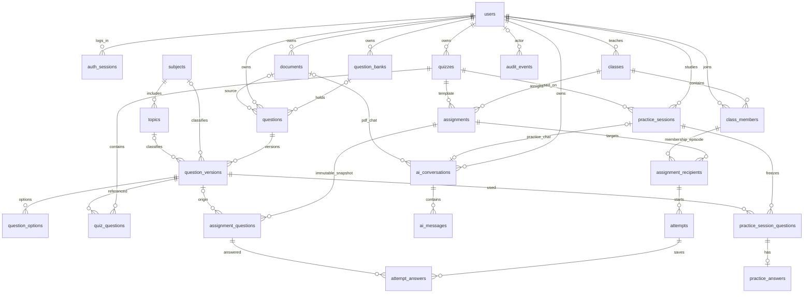

# QuizAI Desktop — ERD tinh gọn 24 bảng (DRAFT v2.0)

**Ngày:** 2026-11-08  
**Trạng thái:** `DESIGN PROPOSAL / CHANGE REQUEST REQUIRED — CHƯA PHÊ DUYỆT SCHEMA V2`  
**Mục tiêu:** đồ án đại học: hoàn thiện trải nghiệm JavaFX + Spring Boot + PostgreSQL + Gemini + HTTPS/REST + WSS + TCP demo; không ưu tiên xử lý chuyên sâu offline, nộp muộn hay chuyển thiết bị.  
**Nguồn đối chiếu:** `PROJECT_DECISIONS_v7.md` (DEC-001…034), `REQUIREMENTS_BASELINE_v1.0.md`, `QUIZAI_DB05_ERD_FINAL_FOR_APPROVAL_v1.0.md` (đã phê duyệt và đã chạy Flyway V1–V8 trên `quizai_dev` và `quizai_test` theo log người dùng cung cấp), `QUIZAI_DB_DESIGN_DECISIONS_v0.19.md`.  
**Đi cùng:** `QUIZAI_CHANGE_REQUEST_CR-001_SIMPLIFIED_MVP.md`.

> **BẢO VỆ DỮ LIỆU:** V1–V8 của schema 37 bảng đã áp dụng không được sửa, xóa, đánh lại số, Flyway repair tùy tiện hoặc DROP/TRUNCATE. Tài liệu này chỉ mô tả mô hình mới **nếu** người dùng duyệt Change Request và ERD v2.0. Không phải SQL hay lệnh triển khai PostgreSQL.

## 1. Triết lý thiết kế

1. Chọn **24 bảng logic**: giảm **13 bảng** so với ERD v1.0, không làm mất các chức năng trình diễn nổi bật.
2. **Giữ:** tài khoản & lớp, mã lớp, ngân hàng câu hỏi, PDF/DOCX/TXT/paste → Gemini tạo câu hỏi, teacher review, quiz tự học, AI chat/PDF tutor, giao bài với số lượt + giờ mở/đóng + công bố điểm/đáp án, snapshot bất biến, lịch sử attempt, điểm cao nhất, teacher aggregate; HTTP REST, WSS event và TCP demo không phải bảng DB.
3. **Đơn giản hóa:** chỉ thi online; đáp án được autosave lên server; khi timeout server chốt **những câu đã nhận**, kể cả 0 câu; không bảo đảm giữ đáp án chưa ACK khi mất mạng. Nộp muộn sau deadline bị từ chối, không có bước teacher late review. Không thiết kế khóa/chuyển thiết bị chuyên dụng.
4. **Giữ bảo mật tối thiểu bắt buộc:** server-side ownership, token hashing, password hashing, không cung cấp lời giải AI khi attempt thi đang diễn ra, không lộ đáp án trước khi công bố, ngăn chỉnh bài đã chấm, hạn/số lượt từ đồng hồ server.
5. Số bảng không phải mục tiêu tự thân. Có **1 điểm dùng JSONB có chủ đích**: một câu snapshot đã giao bao gồm danh sách options và khóa đáp án, vì mục đích bất biến mà không cần bảng snapshot_options riêng. Các quan hệ query phổ biến vẫn là FK thực.

## 2. Danh sách chính xác 24 bảng

| # | Bảng | Vai trò |
|---:|---|---|
| 1 | `users` | STUDENT / TEACHER, đăng ký và trạng thái tài khoản |
| 2 | `auth_sessions` | Phiên đăng nhập và token hash |
| 3 | `classes` | Lớp học, chủ giảng viên, join code HMAC |
| 4 | `class_members` | Episode tham gia/rời lớp |
| 5 | `subjects` | Danh mục môn học toàn hệ thống |
| 6 | `topics` | Chủ đề thuộc môn học |
| 7 | `documents` | Metadata tệp PDF/DOCX/TXT/pasted text và đường dẫn text đã trích xuất |
| 8 | `question_banks` | Ngân hàng câu hỏi của giảng viên |
| 9 | `questions` | Danh tính câu hỏi, owner, nguồn AI/tài liệu |
| 10 | `question_versions` | Nội dung từng version, nháp/duyệt, chủ đề/độ khó |
| 11 | `question_options` | Lựa chọn MCQ đúng/sai theo version |
| 12 | `quizzes` | Bộ đề riêng của teacher/student |
| 13 | `quiz_questions` | Danh sách version câu trong quiz, thứ tự |
| 14 | `practice_sessions` | Mỗi lượt luyện tập của sinh viên |
| 15 | `practice_session_questions` | Đóng băng danh sách version câu theo lượt luyện tập |
| 16 | `practice_answers` | Đáp án luyện tập và kết quả câu |
| 17 | `ai_conversations` | Chat AI theo lượt luyện tập hoặc tài liệu PDF |
| 18 | `ai_messages` | Lịch sử tin nhắn AI |
| 19 | `assignments` | Bài giảng viên giao và cấu hình dashboard |
| 20 | `assignment_recipients` | Sinh viên được giao, gắn episode lớp gốc |
| 21 | `assignment_questions` | **Snapshot bất biến** từng câu và options/answer key trong JSONB |
| 22 | `attempts` | Lượt làm bài, deadline, submit và điểm hiệu lực |
| 23 | `attempt_answers` | Đáp án autosave server của lượt làm |
| 24 | `audit_events` | Nhật ký bảo mật/thay đổi quan trọng mức tối thiểu |

**Không có bảng thứ 25 ẩn:** view, PostgreSQL function, index, check/trigger, bảng quản trị `flyway_schema_history` **không** được tính là bảng nghiệp vụ QuizAI. Không thêm bảng tùy tiện trong khi code.

## 3. Sơ đồ ERD dạng Mermaid



**Chú ý:** Một số quan hệ có owner equality và cross-FK được kiểm chứng bởi server trong transaction; Mermaid không thể hiện hết. `assignment_questions` chỉ giữ `source_question_version_id` làm provenance, chấm từ snapshot chứ không tham chiếu câu hỏi mutable.

## 4. Data dictionary rút gọn (các cột logic quan trọng)

### A — Identity / lớp / catalog (bảng 1–6)

| Bảng | Cột thiết kế | Khóa/ràng buộc cần giữ |
|---|---|---|
| `users` | `id`, `email_normalized`, `password_hash`, `role`, `status`, `created_at` | UUID PK; email unique case-insensitive; role STUDENT/TEACHER; không SUPERADMIN |
| `auth_sessions` | `id`, `user_id`, `token_hash`, `created_at`, `expires_at`, `revoked_at?` | FK user; token hash unique; không chứa token plaintext |
| `classes` | `id`, `teacher_id`, `name`, `join_code_hmac`, `join_enabled`, `created_at` | Teacher owner; partial unique join code HMAC cho mã đang bật, rotate có thể thực hiện |
| `class_members` | `id`, `class_id`, `student_id`, `joined_at`, `left_at?` | Unique partial `(class_id, student_id)` WHERE `left_at IS NULL`; rejoin INSERT episode mới |
| `subjects` | `id`, `code`, `name`, `active` | Code global unique; seed qua system, giáo viên chỉ lựa chọn |
| `topics` | `id`, `subject_id`, `code`, `name`, `active` | FK subject, unique `(subject_id,code)` |

### B — Tệp / câu hỏi / quiz (bảng 7–13)

| Bảng | Cột thiết kế | Khóa/ràng buộc cần giữ |
|---|---|---|
| `documents` | `id`, `owner_id`, `input_type`, `storage_key?`, `extracted_text_storage_key?`, `file_name?`, `mime_type?`, `size_bytes?`, `extraction_status`, `deleted_at?`, `created_at` | PDF/DOCX/TXT/PASTED_TEXT; file và text trích xuất lưu **ngoài DB**, private; owner-only; soft-delete |
| `question_banks` | `id`, `owner_teacher_id`, `name`, `archived_at?` | Teacher-only; bank không chia sẻ |
| `questions` | `id`, `owner_id`, `bank_id?`, `source_document_id?`, `origin` (`AI`/`MANUAL`), `created_at` | Teacher question bank thuộc chính owner; student private `bank_id=NULL`; không cần bảng `ai_generations` |
| `question_versions` | `id`, `question_id`, `version_no`, `stem`, `subject_id?`, `topic_id?`, `difficulty`, `approval_status`, `approved_by?`, `approved_at?` | Unique `(question_id,version_no)`; đã duyệt thì bất biến; sửa tạo version mới |
| `question_options` | `id`, `question_version_id`, `position`, `option_text`, `is_correct` | Unique `(question_version_id,position)`; ít nhất 2 options, đúng 1 khi approve/đem dùng |
| `quizzes` | `id`, `owner_id`, `kind` (`PRACTICE`/`TEACHER_QUIZ`), `title`, `status`, `created_at` | owner-only; không dùng content đang sửa để chấm bài đã giao |
| `quiz_questions` | `id`, `quiz_id`, `question_version_id`, `position` | Unique `(quiz_id,position)`; tái sử dụng version nhiều lần ở nhiều quiz |

**Pipeline AI:** người dùng gửi input → extractor backend → Gemini backend → server kiểm JSON/câu hỏi MCQ → lưu `questions`/`question_versions(DRAFT)`/`question_options`; teacher phải duyệt version trước giao. Không có bảng tiến trình generation nền trong MVP tinh gọn: dùng tác vụ ngắn có lỗi/retry tại API, trả `request_id` để trace log an toàn, không tuyên bố có job queue lâu dài.

### C — Luyện tập / AI (bảng 14–18)

| Bảng | Cột thiết kế | Khóa/ràng buộc cần giữ |
|---|---|---|
| `practice_sessions` | `id`, `student_id`, `quiz_id`, `status`, `started_at`, `finished_at?`, `correct_count?`, `total_questions?` | Chỉ COMPLETED tính vào thống kê; session giữ lịch sử |
| `practice_session_questions` | `id`, `practice_session_id`, `question_version_id`, `position` | Unique `(practice_session_id,position)`; đóng băng version danh sách câu |
| `practice_answers` | `id`, `session_question_id`, `selected_option_id?`, `is_correct?`, `answered_at?` | Unique `(session_question_id)`; selected option thuộc đúng question_version |
| `ai_conversations` | `id`, `owner_student_id`, `conversation_type` (`PRACTICE_SESSION`/`PDF_TUTOR`), `practice_session_id?`, `pdf_document_id?`, `created_at` | XOR context; unique practice_session khi chat practice; PDF owner-only; không có assigned exam AI chat trong CR hiện tại |
| `ai_messages` | `id`, `conversation_id`, `role`, `content`, `created_at`, `practice_session_question_id?` | Thứ tự server, owner-only; không teacher read raw; không log prompt Gemini key |

**Đường AI nổi bật:** tạo đề cá nhân từ PDF → làm practice → xem đáp án/giải thích sau khi hoàn thành → hỏi AI trong cùng conversation; riêng PDF tutor dùng text private trích xuất từ PDF của owner (không cam kết RAG/OCR).

### D — Giao bài / làm bài / audit (bảng 19–24)

| Bảng | Cột thiết kế | Khóa/ràng buộc cần giữ |
|---|---|---|
| `assignments` | `id`, `class_id`, `teacher_id`, `quiz_id`, `title`, `opens_at`, `closes_at`, `duration_minutes`, `max_attempts`, `status`, `score_release_at?`, `answer_release_at?`, `answer_release_mode`, `score_first_available_at?`, `answer_first_available_at?` | Đồng hồ server; releases riêng; chế độ AFTER_VALID_SUBMISSION hoặc AFTER_ASSIGNMENT_CLOSE; không cho retract sau khi đã available |
| `assignment_recipients` | `id`, `assignment_id`, `student_id`, `membership_id`, `assigned_at` | Unique `(assignment_id,student_id)`; episode lớp gốc; join lại không hồi sinh quyền start assignment cũ |
| `assignment_questions` | `id`, `assignment_id`, `source_question_version_id?`, `position`, `snapshot_json` JSONB | Unique `(assignment_id,position)`; JSONB immutable chứa stem/options, stable option keys, **correct answer key**; source chỉ provenance |
| `attempts` | `id`, `assignment_id`, `recipient_id`, `attempt_no`, `start_request_id`, `status`, `started_at`, `deadline_at`, `submitted_at?`, `submit_request_id?`, `submitted_digest?`, `earned_points?`, `possible_points?`, `normalized_score?` | Unique recipient+attempt_no, recipient+start_request_id; `deadline=min(closes_at,start+duration)`; điểm NULL trước khi chốt; nộp timeout trắng = 0 hợp lệ |
| `attempt_answers` | `id`, `attempt_id`, `assignment_question_id`, `selected_option_key?`, `answer_revision`, `server_saved_at` | Unique `(attempt_id,assignment_question_id)`; option phải trong snapshot; không nhận save sau deadline/finalize; owner/assignment consistency |
| `audit_events` | `id`, `actor_id?`, `event_type`, `resource_type`, `resource_id?`, `outcome`, `metadata_sanitized?`, `event_at` | Không lưu mật khẩu/token/nội dung tài liệu/chat; lưu thay đổi release, quyền, lượt thi, sửa câu hỏi và hành động nhạy cảm |

**PK:** 24/24 bảng dùng UUID. **Thời gian:** TIMESTAMPTZ/UTC ở server. **Điểm:** earned, possible integer; `normalized_score` numeric hoặc được tính từ earned/possible, KHÔNG dùng float tùy tiện. Precision vật lý chốt trong PR thiết kế migration v2, không tự thêm bảng scores. `NULL` trước khi có kết quả khác với `0` của lượt thi trắng đã chấm.

## 5. Cấu trúc JSONB snapshot bắt buộc

Một `assignment_questions.snapshot_json` là **bản copy bất biến** của dữ liệu khi teacher publish assignment, ví dụ **minh họa dữ liệu, không phải SQL**:

```json
{
  "schema_version": 1,
  "stem": "Java dùng từ khóa nào để khai báo lớp?",
  "options": [
    {"key": "A", "text": "class"},
    {"key": "B", "text": "object"},
    {"key": "C", "text": "function"}
  ],
  "correct_option_key": "A"
}
```

**Bảo vệ dữ liệu**: API giao đề cho sinh viên đang thi **không được serialize nguyên JSONB**. Server phải project riêng `stem` + `options` không có `correct_option_key`, chỉ trả lời giải khi đủ quyền. Publish transaction phải xác minh JSONB hợp lệ, tối thiểu 2 options, unique keys, chính xác một correct key thuộc danh sách. `snapshot_json` bị cấm UPDATE/DELETE sau publish. Dùng JSONB chỉ cho snapshot options, **không** dùng như cớ gom bừa toàn bộ dữ liệu khác thành JSON.

## 6. Quy tắc chấm điểm và trạng thái tinh gọn

| Trục | Quy tắc tối thiểu |
|---|---|
| `attempts.status` | `IN_PROGRESS`, `SUBMITTED`, `TIMED_OUT` (terminal); không có PENDING_REVIEW/ACCEPTED_LATE/REJECTED_LATE |
| Start | Chỉ active original membership episode, assignment mở, số lần chưa hết; transaction/unique start_request_id chống tạo trùng khi retry |
| Autosave online | Từng câu upsert vào `attempt_answers` có server ACK; revision chống request cũ ghi đè mới; sau timeout/submission từ chối sửa |
| Deadline | `min(assignment.closes_at,attempt.started_at + duration)` do server quyết định; timeout worker hoặc transaction đọc trạng thái chốt với đáp án **đã server nhận** |
| Submit bình thường | Server nhận đúng hạn, lock attempt, tính điểm theo `assignment_questions.snapshot_json`; lưu điểm vào `attempts`, ACK sau COMMIT; retry cùng request/digest trả kết quả cũ, payload khác bị từ chối |
| Timeout không có câu | Chốt thành lượt hợp lệ điểm 0 (`earned_points=0`, `possible_points>0`) |
| Không có attempt đã chấm | Điểm cuối assignment = `NULL` (chưa có điểm), không phải 0 |
| Nhiều lượt | Final score = `MAX(attempts.normalized_score)` trong các attempt terminal hợp lệ. **Không** có candidate multiple versions trong một attempt |
| Nộp sau hạn | Không nhận payload mới sau deadline. Dùng những `attempt_answers` đã server ACK trước hạn để chốt timeout; không xét duyệt late |
| Rời lớp | Không start attempt mới, được finish attempt đã bắt đầu đúng hạn; rejoin tạo membership episode mới, không hồi sinh recipient cũ |
| Công bố | `score_release_at`/`answer_release_at` độc lập; `answer_release_mode`; snapshot answer key ẩn trước khi được phép; không retract khi từng khả dụng |

**Luồng offline giản lược:** khi mất kết nối, hiển thị “Mất kết nối — đáp án chưa xác nhận”; không hứa lưu offline chắc chắn, không cho phép dùng timestamp client tự khai để xin late. Những câu trước đó server ACK vẫn được giữ và auto-finalize khi hết hạn. Đây là **thay đổi phạm vi cần CR**, không thể coi là thỏa mãn DEC-012/023/034 cũ.

## 7. Quyền truy cập

- **Student:** chỉ đọc/sửa private documents, quizzes, practice sessions, AI conversations của mình; chỉ start/nộp assignment_recipient thuộc mình, đúng quyền episode lớp. Không xem đáp án đúng/điểm chưa công bố.
- **Teacher:** tạo lớp thuộc mình, quản lý bank/quiz/assignment của mình; review từng câu AI trước publish; xem kết quả của assignments mình quản lý; chỉ xem **thống kê tổng hợp** của các completed practice_sessions sinh viên trong khoảng membership `[joined_at,left_at)`; không xem private file/chat/quiz/answers raw của student.
- **Gemini:** chỉ server nắm API key; không AI help qua QuizAI khi student có bất kỳ assigned attempt `IN_PROGRESS`, bao gồm nút PDF tutor/practice chat cũ.
- **Hệ thống:** role self-register teacher có quyền ngay (không SUPERADMIN); owner equality/service guards; file private ngoài public webroot; HMAC join code có key riêng; rate-limit authentication và join.

## 8. Luồng DEMO dự kiến bảo vệ đồ án

1. Teacher tạo tài khoản, lớp “Java căn bản”, tạo mã join.
2. Student tạo tài khoản, tham gia lớp bằng mã.
3. Teacher upload PDF/DOCX/TXT hoặc paste → Gemini tạo 10 câu → teacher duyệt/sửa từng câu → đưa vào bank và tạo quiz.
4. Teacher giao quiz như **Ôn tập**: 3 lần, cho xem đáp án sau nộp; student làm lại, xem lịch sử và điểm cao nhất.
5. Teacher tạo bài **Kiểm tra**: 1 lần, 20 phút, điểm và đáp án công bố theo lịch; student làm, submit, teacher xem bảng điểm.
6. Student học riêng bằng tài liệu PDF, làm quiz tự học, bấm AI giải thích và mở PDF tutor.
7. WSS thông báo có bài mới/đã chấm (không gửi raw đáp án bị khóa); TCP LAN demo heartbeat/ACK trên module riêng.

**Cần demo thực tế, không nhận tuyên bố PASS khi chỉ có fixture/UI mẫu.**

## 9. Ánh xạ 37 bảng cũ → 24 bảng mới

### 9.1. Giữ nguyên tên logic (23 bảng)

`users`, `auth_sessions`, `classes`, `class_members`, `subjects`, `topics`, `documents`, `question_banks`, `questions`, `question_versions`, `question_options`, `quizzes`, `quiz_questions`, `practice_sessions`, `practice_session_questions`, `practice_answers`, `ai_conversations`, `ai_messages`, `assignments`, `assignment_recipients`, `attempts`, `attempt_answers`, `audit_events`.

### 9.2. Đổi tên (1 bảng)

- `assignment_question_snapshots` → `assignment_questions`: lưu options/answer key JSONB **bên trong mỗi row snapshot**; copy bất biến tại publish.

### 9.3. Không còn bảng riêng (13 bảng)

| Bảng v1.0 bỏ | Thay thế hoặc lý do |
|---|---|
| `document_extractions` | `documents.extracted_text_storage_key`, status/version metadata |
| `ai_generations` | Metadata nguồn AI trên `questions`; gọi Gemini synchronous/bounded; chưa lưu job queue |
| `assignment_snapshot_options` | Danh sách options + correct key trong `assignment_questions.snapshot_json` |
| `assignment_publication_events` | `assignments.score_first_available_at` / `.answer_first_available_at` + guard tính khả dụng tại cập nhật |
| `attempt_device_bindings` | Hoãn ràng buộc một thiết bị mỗi attempt |
| `device_transfer_requests` | Hoãn chuyển máy được phê duyệt |
| `submission_candidates` | Không còn canonical timeout/late version song song |
| `submission_candidate_answers` | Chỉ `attempt_answers` server ACK là nguồn trước khi submit |
| `late_submission_reviews` | Hoãn review nộp muộn |
| `submission_scores` | Điểm đã chốt trong `attempts` |
| `attempt_result_events` | Hoãn thay đổi effective candidate sau late review |
| `assignment_recipient_score_events` | Điểm không có late score adjustment; history mỗi attempt vẫn còn trong `attempts` |
| `idempotency_receipts` | Unique start_request_id + submit_request_id/digest và trạng thái terminal trực tiếp trong `attempts` |

**Trade-offs cần chấp nhận có chủ đích:** không có đầy đủ audit sự kiện công bố/điểm như v1, không có lịch sử job Gemini; logic JSONB snapshot khó query SQL hơn; nộp muộn bị từ chối; mất mạng không có khôi phục full offline. Đây là các giới hạn phải trình bày trong báo cáo đồ án thay vì quảng cáo quá mức.

## 10. Các ràng buộc/kiểm thử tối thiểu trước khi trình duyệt vật lý

1. Unique email case-insensitive; role/owner checks; login token hashed.
2. One active class membership, episode mới khi rejoin; assignment recipients membership gốc.
3. Teacher bank owner; topic thuộc subject; option belongs version; một MCQ correct khi approved.
4. Approved question version bất biến; snapshot JSONB publish bất biến và correct key không bị lộ.
5. At most one practice AI conversation/session; PDF tutor only own PDF.
6. Only completed practice sessions in teacher aggregate, thời điểm finish nằm trong episode; không leak raw.
7. Max attempts, double-click start, retry same start_request_id, limit timestamps server.
8. Autosave reorder, retry submit, submit vs timeout race; đúng một terminal state và điểm.
9. Timeout 0 câu = 0, no attempts = NULL, MAX across eligible attempts only.
10. Score release vs answer release independent; no retract after available; in-progress AI blockade.
11. Vẫn phải test JavaFX Client/Admin REST và WSS metadata; TCP demo riêng không có DB.
12. Không có API nộp sau hạn “được chấp thuận” trong bản tinh gọn.

## 11. Kế hoạch chuyển đổi KHÔNG PHÁ DỮ LIỆU

**Current production-like facts từ log người dùng:** local PostgreSQL 18.6, `quizai_test` & `quizai_dev` đã chạy V1–V8, 37 bảng mỗi DB. Thông tin có được từ log triển khai, **không phải kết nối thực tế từ tài liệu này**. Không thể khẳng định DB rỗng dữ liệu chỉ từ log cũ (trừ acceptance fixture rollback tại thời điểm chạy).

- `GATE V2-0` — duyệt CR-001 và ERD v2.0; đóng băng mọi P3/P4-A đang triển khai theo 37 bảng trước khi chuyển.
- `GATE V2-1` — tạo **database mới độc lập**, đề xuất `quizai_v2_test` và `quizai_v2_dev`, với users/credentials riêng hoặc quyền tối thiểu. KHÔNG tái sử dụng DB cũ khi đang review.
- `GATE V2-2` — lập Flyway **bộ migration mới** (ví dụ folder `db/migration-v2` trong một branch riêng) từ schema v2 cho DB v2 rỗng. Không sửa V1–V8 v1 đã chạy.
- `GATE V2-3` — kiểm thử trên `quizai_v2_test`, verify đúng 24 bảng business + Flyway history, PK/FK/unique, test owner/cross-FK và dữ liệu mẫu rollback.
- `GATE V2-4` — code API nghiệp vụ & JavaFX theo v2, chạy các luồng demo với `quizai_v2_dev` và integration tests.
- `GATE V2-5` — nếu DB cũ có dữ liệu có giá trị, lập **data mapping/migration riêng** và xác minh trước khi chuyển; không tự ý drop/truncate. Nếu dữ liệu cũ chỉ là schema rỗng vẫn giữ nguyên cho tới khi chủ dự án chấp nhận dọn.

**STOP:** Chưa chạy bất kỳ bước gate nào. Bản thiết kế chưa được user phê duyệt; không tạo SQL, Flyway migration, JPA/JDBC mapping v2 hoặc sửa PostgreSQL lúc này.

## 12. Các mục cần ký duyệt cuối

- [ ] Đồng ý phạm vi **online-first**, hoãn offline/review late/device transfer (xem CR-001).
- [ ] Đồng ý đúng **24 bảng**, giữ nguyên các điểm AI trong mục 1.
- [ ] Đồng ý snapshot option/answer JSONB trong `assignment_questions` thay vì bảng riêng.
- [ ] Đồng ý không giữ generation job/audit score change phức tạp ở MVP.
- [ ] Đồng ý chỉ triển khai mới trên các database `quizai_v2_test` / `quizai_v2_dev` sau phê duyệt và cấp quyền riêng.
- [ ] Xác nhận `AI-ASSIGNED-POST-01` vẫn **ngoài MVP**, trừ khi duyệt CR bổ sung riêng.
